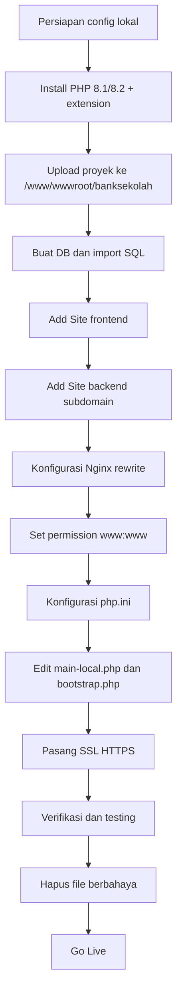

# Panduan Deployment — Bank Sekolah (Yii2 Advanced) di aaPanel

Dokumen ini adalah panduan langkah demi langkah untuk men-deploy aplikasi **Bank Sekolah** (Yii2 Advanced Template) ke server yang dikelola dengan **aaPanel**, menggunakan **Nginx**, **PHP 8.1/8.2**, dan **MySQL 8.0**.

> **Catatan Umum**
> - Ganti seluruh placeholder berikut dengan nilai Anda sendiri:
>   - `domain-anda.com` → domain utama (contoh: `banksekolah.com`)
>   - `admin.domain-anda.com` → subdomain panel admin (contoh: `admin.banksekolah.com`)
>   - `/www/wwwroot/banksekolah` → direktori proyek di server
>   - `banksekolah_db` / `banksekolah_user` / `PASSWORD_KUAT_ANDA` → kredensial database produksi
> - Dokumen ini **tidak** mencakup instalasi aaPanel dari nol. Diasumsikan aaPanel sudah terpasang dan dapat diakses.
> - Jangan menjalankan `chmod 777` pada direktori apa pun. Gunakan kepemilikan `www:www` + permission `755`/`775`.

---

## 1. Ringkasan Proyek

| Item | Keterangan |
| --- | --- |
| Nama Aplikasi | Bank Sekolah |
| Framework | Yii2 **Advanced Template** (`yiisoft/yii2` **2.0.51**) |
| Versi PHP | **8.1 atau 8.2** (WAJIB) |
| Database | MySQL **8.0+** / MariaDB **10.2+** |
| Nama Database | `banksekolah_banksekolah` (nilai saat ini) |
| Charset Database | `utf8mb4` (dump SQL sudah utf8mb4) |
| Entry Point Frontend | [`frontend/web/index.php`](frontend/web/index.php) → `YII_ENV=prod`, `YII_DEBUG=false` |
| Entry Point Backend | [`backend/web/index.php`](backend/web/index.php) |
| Document Root Frontend | `/www/wwwroot/banksekolah/frontend/web` |
| Document Root Backend | `/www/wwwroot/banksekolah/backend/web` (disarankan subdomain terpisah) |
| Dependency | `vendor/` **sudah tersedia lengkap** di root proyek (di-ignore git) |
| File SQL | [`banksekolah_banksekolah.sql`](banksekolah_banksekolah.sql) (root proyek, ±99.160 baris) |
| Web Server | Nginx (aaPanel) — **tidak membaca `.htaccess`**, rewrite harus manual |

### Alur Deployment Singkat



---

## 2. Prasyarat

### 2.1 Spesifikasi Server Minimum

| Komponen | Minimum | Rekomendasi |
| --- | --- | --- |
| CPU | 1 vCPU | 2 vCPU |
| RAM | 1 GB | 2–4 GB |
| Disk | 10 GB | 20 GB+ (untuk backup & upload) |
| OS | Ubuntu 20.04 / CentOS 7 / AlmaLinux 8 | Ubuntu 22.04 / AlmaLinux 9 |

### 2.2 Versi PHP

| Versi | Status | Keterangan |
| --- | --- | --- |
| PHP ≤ 8.0 | ❌ Tidak didukung | `phpoffice/phpspreadsheet` 2.2.1 membutuhkan `^8.1` |
| **PHP 8.1** | ✅ **Direkomendasikan** | Paling stabil untuk stack ini |
| **PHP 8.2** | ✅ Didukung | Alternatif yang aman |
| PHP 8.3 / 8.4 | ⚠️ Berisiko | Hindari; kemungkinan deprecation/breaking change pada dependency lama |
| PHP CLI | ≥ 8.1 | Wajib jika menjalankan `yii` atau migration |

### 2.3 Extension PHP Wajib

Semua extension berikut harus **aktif** pada versi PHP yang dipakai:

| Kategori | Extension |
| --- | --- |
| Inti & String | `openssl`, `mbstring`, `ctype`, `iconv`, `pcre`, `json` |
| Database | `pdo`, `pdo_mysql` |
| XML / DOM | `dom`, `xml`, `xmlreader`, `xmlwriter`, `simplexml`, `libxml` |
| Arsip & File | `zip`, `zlib`, `fileinfo` |
| Gambar | `gd` (dengan **FreeType**) atau `imagick` |
| HTTP | `curl` |

> **Penting:** `gd` wajib dikompilasi dengan dukungan **FreeType** (`--with-freetype`) karena digunakan untuk captcha / manipulasi gambar. Jika tidak tersedia, gunakan `imagick`.

### 2.4 Database

- MySQL **8.0+** atau MariaDB **10.2+** (dump dibuat dengan MySQL 8.0.46).
- Charset `utf8mb4` dan collation `utf8mb4_general_ci` (atau `utf8mb4_unicode_ci`).

---

## 3. Persiapan Sebelum Upload

Lakukan langkah ini **di komputer lokal** sebelum file diunggah ke server.

### 3.1 Edit Kredensial Database

File: [`common/config/main-local.php`](common/config/main-local.php)

Nilai saat ini:

```php
'db' => [
    'class' => 'yii\db\Connection',
    'dsn' => 'mysql:host=localhost;dbname=banksekolah_banksekolah',
    'username' => 'banksekolah_banksekolah',
    'password' => 'BanksekolahDB1',
    'charset' => 'utf8',
],
```

Ubah menjadi (sesuaikan dengan kredensial produksi):

```php
'db' => [
    'class' => 'yii\db\Connection',
    'dsn' => 'mysql:host=localhost;dbname=banksekolah_db;charset=utf8mb4',
    'username' => 'banksekolah_user',
    'password' => 'PASSWORD_KUAT_ANDA',
    'charset' => 'utf8mb4',
    'enableSchemaCache' => true,
    'schemaCacheDuration' => 3600,
    'schemaCache' => 'cache',
],
```

> **Wajib:** ganti `charset` dari `utf8` menjadi **`utf8mb4`** agar emoji dan karakter 4-byte tersimpan dengan benar.

### 3.2 Edit Alias Domain

File: [`common/config/bootstrap.php`](common/config/bootstrap.php)

Alias yang **hardcoded** dan harus disesuaikan:

| Alias | Nilai saat ini | Keterangan |
| --- | --- | --- |
| `@backurl` | `https://banksekolah.com/backend/web` | URL panel admin |
| `@fronturl` | `https://banksekolah.com` | URL situs utama |
| `@uploads` | `<root>/backend/web/uploads` | Path fisik upload admin |
| `@posts` | `<root>/frontend/web/uploads` | Path fisik upload frontend |

Contoh penyesuaian:

```php
Yii::setAlias('@uploads', dirname(dirname(__DIR__)) . '/backend/web/uploads');
Yii::setAlias('@posts', dirname(dirname(__DIR__)) . '/frontend/web/uploads');
Yii::setAlias('@fronturl', 'https://domain-anda.com');
Yii::setAlias('@backurl', 'https://admin.domain-anda.com');
```

> **Perhatian:** file ini juga memiliki percabangan `if ($_SERVER['SERVER_NAME'] == 'banksekolah.test')` dan `'192.168.0.4'`. Pastikan cabang `else` (fallback produksi) berisi domain yang benar, atau hapus cabang pengembangan agar tidak membingungkan.

### 3.3 Hapus File Berbahaya Sebelum Upload

Jalankan di root proyek **sebelum** upload:

```bash
# Adminer — akses database tanpa autentikasi aplikasi
rm -f backend/web/db.php

# phpinfo() — membocorkan konfigurasi server
rm -f backend/web/info.php

# Controller mysqldump tanpa otorisasi (RCE/backdoor risk)
rm -f frontend/controllers/DatabaseController.php

# File backup yang tidak perlu di produksi
rm -f backend/views/transaction-history/index.php.bak.php
rm -f backend/views/site/login.php.bak

# Semua file error_log yang tersebar
find . -type f -name "error_log" -delete
```

### 3.4 Amankan API Key Mailchimp

File: [`frontend/controllers/SubscribeController.php`](frontend/controllers/SubscribeController.php)

API key Mailchimp **hardcoded** pada `actionMailchimp()` (baris ±75–85). Pindahkan ke environment variable / file config yang tidak di-commit:

```php
// JANGAN hardcode seperti ini
$mailchimp->setConfig([
    'apiKey' => getenv('MAILCHIMP_API_KEY'),
    'server' => getenv('MAILCHIMP_SERVER'),
]);
```

Jika fitur Mailchimp tidak dipakai, **hapus method** `actionMailchimp()` beserta `use` statement terkait.

> **Tindakan segera:** key yang sudah terekspos sebaiknya di-*revoke* dan dibuat ulang di dashboard Mailchimp.

### 3.5 Nonaktifkan Modul Gii

File: [`backend/config/main.php`](backend/config/main.php) baris 14–16:

```php
'bootstrap' => ['log'],
'modules' => [
    'gii' => 'yii\gii\Module'   // <-- HAPUS BLOK INI DI PRODUKSI
],
```

Menjadi:

```php
'bootstrap' => ['log'],
// modul gii dihapus di produksi
```

### 3.6 Exclude File yang Tidak Boleh Diunggah

Jangan pernah mengunggah folder/file berikut ke server:

| Item | Alasan |
| --- | --- |
| `banksekolahgit/` | Duplikat penuh proyek (membingungkan & memboroskan ruang) |
| `git.zip` | Arsip duplikat proyek |
| `error_log` (semua lokasi) | Membocorkan path & stack trace |
| `database/*.sql` (dump lama) | Hanya gunakan `banksekolah_banksekolah.sql` |
| `.git/` | Riwayat source code |
| `frontend/web/theme/assets.zip` | Arsip tidak terpakai |

### 3.7 Jangan Jalankan `init`

**`init` TIDAK wajib dijalankan** karena konfigurasi produksi sudah tersedia.

> ⚠️ **Risiko:** menjalankan `php init --env=Production` akan **MENIMPA** `common/config/main-local.php` dengan placeholder `yii2advanced` / `root`, sehingga aplikasi gagal konek database.

Yang cukup dipastikan:
1. `common/config/main-local.php` berisi kredensial DB yang benar.
2. `frontend/config/main-local.php` memiliki `cookieValidationKey` yang terisi (saat ini sudah terisi; disarankan generate baru):

```bash
# Generate key baru (opsional, dijalankan lokal)
openssl rand -base64 32
```

Isi ke [`frontend/config/main-local.php`](frontend/config/main-local.php):

```php
'request' => [
    'cookieValidationKey' => 'HASIL_GENERATE_RANDOM_32_BYTE',
],
```

Pastikan juga `backend/config/main-local.php` memiliki `cookieValidationKey` sendiri (nilai berbeda).

---

## 4. Instalasi aaPanel

Diasumsikan aaPanel sudah terpasang dan login panel berhasil.

### 4.1 Paket yang Harus Diinstall dari App Store

| No | Paket | Versi / Catatan |
| --- | --- | --- |
| 1 | **Nginx** | 1.22+ (wajib; bukan Apache) |
| 2 | **MySQL** | **8.0** (minimal) |
| 3 | **PHP** | **8.1** atau **8.2** |
| 4 | **phpMyAdmin** | Untuk import SQL & verifikasi tabel |
| 5 | (Opsional) Redis | Untuk cache/session jika dibutuhkan |
| 6 | (Opsional) Fail2ban | Proteksi brute-force login |

### 4.2 Langkah Instalasi Paket

1. Buka **aaPanel → App Store**.
2. Cari `Nginx` → **Install** (pilih versi stabil terbaru).
3. Cari `MySQL` → **Install** versi **8.0**.
4. Cari `PHP` → **Install** versi **8.1** (atau 8.2).
5. Cari `phpMyAdmin` → **Install**.
6. Tunggu seluruh proses kompilasi selesai (bisa memakan waktu cukup lama pada server kecil).
7. Verifikasi melalui terminal server:

```bash
nginx -v
mysql --version
php -v
```

> **Catatan:** aaPanel menggunakan **satu PHP-FPM pool per versi**. Semua situs harus diarahkan ke versi PHP yang sama (`8.1`/`8.2`) agar konsisten.

---

## 5. Install PHP 8.1/8.2 + Extension

### 5.1 Install Extension via GUI aaPanel

1. Buka **App Store → PHP-8.1** (atau `PHP-8.2`) → klik **Setting**.
2. Masuk tab **Install extension**.
3. Install extension berikut satu per satu (status harus **On** / hijau):

```text
openssl, pdo, pdo_mysql, mbstring, ctype, dom, xml, xmlreader, xmlwriter,
simplexml, libxml, zip, zlib, fileinfo, iconv, gd, curl, json, pcre
```

4. Untuk **gd**, klik **Setting** pada baris `gd` dan pastikan **FreeType** terpasang. Jika tidak bisa, install `imagick` sebagai alternatif.
5. Klik **Reload** PHP-FPM setelah semua extension aktif.

### 5.2 Verifikasi Extension via CLI

```bash
# Ganti 81 dengan versi PHP yang dipakai (81 / 82)
/www/server/php/81/bin/php -m | sort
```

Pastikan output memuat: `openssl`, `pdo_mysql`, `mbstring`, `dom`, `zip`, `fileinfo`, `gd`, `curl`, `xml`, `simplexml`.

Cek juga dukungan FreeType pada GD:

```bash
/www/server/php/81/bin/php -r "print_r(gd_info());" | grep -i freetype
```

### 5.3 Samakan PHP CLI

```bash
# Cek versi CLI default
php -v

# Jika CLI masih versi lama, arahkan ulang (opsional)
ln -sf /www/server/php/81/bin/php /usr/bin/php
php -v
```

> PHP CLI ≥ 8.1 diperlukan jika Anda menjalankan `./yii migrate` atau perintah console lain. Jika restore dari SQL dump, langkah ini boleh dilewati.

---

## 6. Upload File Proyek

### 6.1 Siapkan Direktori Tujuan

```bash
mkdir -p /www/wwwroot/banksekolah
```

### 6.2 Metode 1 — File Manager aaPanel

1. Buka **Files → /www/wwwroot/banksekolah**.
2. Klik **Upload** → unggah arsip proyek (`.zip`).
3. Klik kanan arsip → **Unzip**.
4. Pastikan struktur menjadi:

```text
/www/wwwroot/banksekolah/
├── backend/
├── common/
├── console/
├── environments/
├── frontend/
├── vendor/            <-- WAJIB ADA (sudah lengkap)
├── yii
├── composer.json
├── banksekolah_banksekolah.sql
└── ...
```

### 6.3 Metode 2 — Rsync via SSH (Direkomendasikan)

```bash
rsync -avz --progress \
  --exclude='.git' \
  --exclude='banksekolahgit' \
  --exclude='git.zip' \
  --exclude='error_log' \
  --exclude='database/' \
  /path/lokal/banksekolah/ \
  root@IP_SERVER:/www/wwwroot/banksekolah/
```

### 6.4 Metode 3 — SCP Arsip

```bash
# Dari komputer lokal
scp banksekolah.zip root@IP_SERVER:/www/wwwroot/banksekolah/

# Di server
cd /www/wwwroot/banksekolah
unzip banksekolah.zip
rm banksekolah.zip
```

### 6.5 Catatan Penting soal `vendor/`

- Folder `vendor/` **sudah tersedia lengkap** di proyek dan **wajib diunggah**.
- `vendor/` di-ignore oleh git, sehingga **tidak akan ada** jika Anda clone dari repository.
- Jika `vendor/` tidak ada di server, jalankan Composer (butuh PHP CLI ≥ 8.1 dan akses internet):

```bash
cd /www/wwwroot/banksekolah
php /usr/local/bin/composer install --no-dev --optimize-autoloader
```

- Jangan menjalankan `composer update` di produksi (dapat mengubah versi dependency secara tak terduga).

### 6.6 Verifikasi Struktur File Kritis

```bash
cd /www/wwwroot/banksekolah
ls -l frontend/web/index.php backend/web/index.php vendor/autoload.php common/config/main-local.php
```

Keempat file harus ada. Jika `vendor/autoload.php` tidak ada, entry point akan gagal total.

---

## 7. Buat Database & Import SQL

### 7.1 Buat Database dan User di aaPanel

1. Buka **Databases → Add Database**.
2. Isi:
   - **Database name:** `banksekolah_db`
   - **Username:** `banksekolah_user`
   - **Password:** `PASSWORD_KUAT_ANDA`
   - **Charset:** `utf8mb4`
   - **Access:** `localhost` (hanya lokal)
3. Klik **Submit**, lalu catat kredensialnya.

### 7.2 Import SQL via phpMyAdmin

1. Buka **phpMyAdmin** dari aaPanel.
2. Pilih database `banksekolah_db`.
3. Tab **Import** → **Choose File** → pilih `banksekolah_banksekolah.sql`.
4. Pastikan **Character set of the file:** `utf8mb4`.
5. Klik **Go** dan tunggu hingga selesai (±99.160 baris).

### 7.3 Import SQL via CLI (Lebih Cepat & Stabil)

```bash
cd /www/wwwroot/banksekolah

mysql -u banksekolah_user -p banksekolah_db \
  --default-character-set=utf8mb4 \
  < banksekolah_banksekolah.sql
```

Atau sebagai root:

```bash
mysql -u root -p banksekolah_db --default-character-set=utf8mb4 < banksekolah_banksekolah.sql
```

### 7.4 Verifikasi Hasil Import

```bash
mysql -u banksekolah_user -p banksekolah_db -e "SHOW TABLES;" | wc -l
mysql -u banksekolah_user -p banksekolah_db -e "SHOW CREATE DATABASE banksekolah_db\G"
```

Pastikan charset database tampil `utf8mb4`.

### 7.5 Sesuaikan Konfigurasi Aplikasi

Pastikan nilai di [`common/config/main-local.php`](common/config/main-local.php) **sama persis** dengan database yang dibuat:

| Parameter | Nilai |
| --- | --- |
| host | `localhost` |
| dbname | `banksekolah_db` |
| username | `banksekolah_user` |
| password | `PASSWORD_KUAT_ANDA` |
| charset | `utf8mb4` |

> **Jangan** gunakan user `root` untuk aplikasi. Buat user khusus dengan hak akses hanya pada database aplikasi.

---

## 8. Buat Website di aaPanel

### 8.1 Situs Frontend (Domain Utama)

1. Buka **Website → Add Site**.
2. Isi:
   - **Domain:** `domain-anda.com`
   - **Root directory:** `/www/wwwroot/banksekolah/frontend/web`
   - **FTP:** tidak perlu
   - **Database:** tidak perlu (sudah dibuat)
   - **PHP version:** `8.1` (atau `8.2`)
3. Klik **Submit**.

> **KRITIS:** Document root **WAJIB** menunjuk ke `frontend/web`, **bukan** ke root proyek. Jika salah, seluruh source code (`config`, `vendor`, `.sql`) dapat diakses publik.

### 8.2 Situs Backend (Subdomain Admin)

Disarankan memakai subdomain terpisah agar panel admin terisolasi:

1. **Website → Add Site**.
2. Isi:
   - **Domain:** `admin.domain-anda.com`
   - **Root directory:** `/www/wwwroot/banksekolah/backend/web`
   - **PHP version:** `8.1` (sama dengan frontend)
3. Klik **Submit**.
4. Buat DNS record `A` untuk `admin.domain-anda.com` → IP server.

### 8.3 Alternatif: Backend di Sub-path

Jika tidak memungkinkan subdomain, akses backend via `https://domain-anda.com/backend/web/...`. Namun konfigurasi Nginx harus ditambahkan manual (lihat Section 9.3), dan risiko kebocoran file lebih tinggi.

### 8.4 Cek Konfigurasi Site

```bash
ls -l /www/server/panel/vhost/nginx/
```

Akan terlihat file seperti `domain-anda.com.conf` dan `admin.domain-anda.com.conf`.

---

## 9. Konfigurasi Nginx Rewrite

> **PENTING:** aaPanel (Nginx) **tidak membaca** `.htaccess` maupun `.user.ini`. Semua aturan rewrite Apache di [`frontend/web/.htaccess`](frontend/web/.htaccess) **harus** diterjemahkan ke konfigurasi Nginx. [`backend/web/.htaccess`](backend/web/.htaccess) seluruh isinya dikomentari, dan `urlManager` backend juga dinonaktifkan.

### 9.1 Konfigurasi Frontend

Buka **Website → domain-anda.com → Config** (atau edit `/www/server/panel/vhost/nginx/domain-anda.com.conf`). Pastikan blok `server` berisi:

```nginx
server {
    listen 80;
    listen 443 ssl http2;
    server_name domain-anda.com www.domain-anda.com;

    root /www/wwwroot/banksekolah/frontend/web;
    index index.php index.html;

    # ---- Yii2 pretty URL ----
    location / {
        try_files $uri $uri/ /index.php?$args;
    }

    # ---- Blokir akses langsung ke file sensitif ----
    location ~* ^/(vendor|common|console|backend|environments|database)/ {
        deny all;
        return 404;
    }
    location ~* \.(sql|log|ini|bak|md|json|lock)$ {
        deny all;
        return 404;
    }
    location = /db.php { deny all; }
    location = /info.php { deny all; }

    # ---- Static assets: cache panjang ----
    location ^~ /assets/ {
        expires 30d;
        add_header Cache-Control "public, max-age=2592000";
        try_files $uri =404;
    }
    location ~* \.(css|js|jpg|jpeg|png|gif|svg|webp|ico|woff2?|ttf|eot)$ {
        expires 30d;
        access_log off;
    }

    # ---- PHP ----
    include enable-php-81.conf;

    # ---- Upload frontend ----
    location ^~ /uploads/ {
        try_files $uri =404;
    }
}
```

> Sesuaikan `include enable-php-81.conf;` dengan versi PHP Anda (`enable-php-82.conf` untuk PHP 8.2). aaPanel menyediakan file include ini di `/www/server/nginx/conf/`.

### 9.2 Konfigurasi Backend

Untuk subdomain `admin.domain-anda.com` (root: `backend/web`):

```nginx
server {
    listen 80;
    listen 443 ssl http2;
    server_name admin.domain-anda.com;

    root /www/wwwroot/banksekolah/backend/web;
    index index.php index.html;

    # Backend menggunakan index.php?r=... (pretty URL OFF)
    location / {
        try_files $uri $uri/ /index.php?$args;
    }

    # Blokir file sensitif
    location = /db.php { deny all; }
    location = /info.php { deny all; }
    location ~* \.(sql|log|ini|bak|md|json|lock)$ {
        deny all;
        return 404;
    }

    # Assets backend (hasil publish Yii)
    location ^~ /assets/ {
        expires 30d;
        add_header Cache-Control "public, max-age=2592000";
        try_files $uri =404;
    }

    # Upload backend
    location ^~ /uploads/ {
        try_files $uri =404;
    }

    include enable-php-81.conf;
}
```

> **Catatan URL Backend:** karena `urlManager` di [`backend/config/main.php`](backend/config/main.php) dikomentari, backend diakses dengan format:
> - `https://admin.domain-anda.com/`
> - `https://admin.domain-anda.com/index.php?r=site/login`
>
> Jika menginginkan `https://admin.domain-anda.com/site/login`, aktifkan `urlManager` di backend:

```php
'urlManager' => [
    'enablePrettyUrl' => true,
    'showScriptName' => false,
    'rules' => [],
],
```

Setelah itu rewrite Nginx di atas akan otomatis menangani pretty URL.

### 9.3 Opsional: Backend di Sub-path

Jika backend diakses via `https://domain-anda.com/backend/web/`, tambahkan blok berikut **di dalam** `server` frontend:

```nginx
location /backend/web/ {
    alias /www/wwwroot/banksekolah/backend/web/;
    index index.php;
    try_files $uri $uri/ /backend/web/index.php?$args;
}
```

> Pendekatan ini kurang aman dan lebih sulit di-maintain. Subdomain tetap direkomendasikan.

### 9.4 Test & Reload Nginx

```bash
nginx -t
nginx -s reload
```

Jika `nginx -t` gagal, periksa pesan error baris berapa yang bermasalah.

---

## 10. Set Permission & Ownership

### 10.1 Kepemilikan

Web server aaPanel berjalan sebagai user `www`:

```bash
cd /www/wwwroot/banksekolah
chown -R www:www /www/wwwroot/banksekolah
```

### 10.2 Permission Direktori Writable

Yii2 membutuhkan direktori berikut **dapat ditulis** oleh `www`:

| Direktori | Kegunaan |
| --- | --- |
| `backend/runtime` | Log, cache backend |
| `frontend/runtime` | Log, cache frontend |
| `console/runtime` | Log console |
| `backend/web/assets` | Hasil publish asset backend |
| `frontend/web/assets` | Hasil publish asset frontend |
| `backend/web/uploads` | File upload admin |

Perintah:

```bash
cd /www/wwwroot/banksekolah

# Pastikan direktori ada
mkdir -p backend/runtime frontend/runtime console/runtime \
         backend/web/assets frontend/web/assets backend/web/uploads

# Permission standar: folder 755, file 644
find backend/runtime frontend/runtime console/runtime \
     backend/web/assets frontend/web/assets backend/web/uploads \
     -type d -exec chmod 755 {} \;
find backend/runtime frontend/runtime console/runtime \
     backend/web/assets frontend/web/assets backend/web/uploads \
     -type f -exec chmod 644 {} \;

# Beri group-write pada direktori writable
chmod -R g+w backend/runtime frontend/runtime console/runtime \
             backend/web/assets frontend/web/assets backend/web/uploads
```

### 10.3 Subfolder Upload

Analisis menyebutkan subfolder upload: `banner`, `media`, `pages`, `posts`, `category`, `database`, `import`. Pada repository saat ini yang terlihat adalah `import/`, `school/`, `user/`. Pastikan **semua** subfolder yang benar-benar ada dapat ditulis:

```bash
find backend/web/uploads -type d -exec chown www:www {} \;
find backend/web/uploads -type d -exec chmod 755 {} \;
find backend/web/uploads -type d -exec chmod g+w {} \;
```

Buat subfolder yang belum ada (aman jika sudah ada):

```bash
mkdir -p backend/web/uploads/{banner,media,pages,posts,category,database,import}
chown -R www:www backend/web/uploads
chmod -R 755 backend/web/uploads && chmod -R g+w backend/web/uploads
```

### 10.4 File Console

```bash
chmod 755 /www/wwwroot/banksekolah/yii
```

### 10.5 JANGAN Gunakan 777

```bash
# ❌ JANGAN LAKUKAN INI
# chmod -R 777 backend frontend
```

`777` membuat file dapat dieksekusi/ditulis oleh siapa pun dan merupakan risiko keamanan serius. Gunakan `755` (folder) / `644` (file) dengan owner `www:www`, dan `775` hanya bila benar-benar butuh group-write.

### 10.6 Verifikasi

```bash
ls -ld backend/runtime frontend/runtime backend/web/assets frontend/web/assets
sudo -u www test -w backend/web/assets && echo "assets writable OK"
```

---

## 11. Konfigurasi PHP (php.ini)

### 11.1 Setting yang Disarankan

| Directive | Nilai | Alasan |
| --- | --- | --- |
| `display_errors` | `Off` | Cegah bocornya path/stack trace ke publik |
| `log_errors` | `On` | Error tetap tercatat di log |
| `memory_limit` | `256M` | Import Excel / generate PDF |
| `max_execution_time` | `300` | Proses import & report berat |
| `max_input_vars` | `3000` | Form dengan banyak field |
| `upload_max_filesize` | `50M` | Upload Excel/gambar |
| `post_max_size` | `50M` | Harus ≥ `upload_max_filesize` |
| `max_file_uploads` | `20` | Upload multi-file |
| `session.save_path` | `/tmp` | Path writable & cepat |
| `expose_php` | `Off` | Sembunyikan versi PHP dari header |
| `allow_url_include` | `Off` | Cegah RFI |
| `allow_url_fopen` | `On` | Dibutuhkan beberapa library |
| `date.timezone` | `Asia/Jakarta` | Konsistensi waktu |
| `opcache.enable` | `1` | Performa |
| `opcache.validate_timestamps` | `1` | Perubahan file langsung terdeteksi |
| `post_max_size` & `upload_max_filesize` | sama | Hindari upload terpotong diam-diam |

### 11.2 Cara Edit di aaPanel

1. **App Store → PHP-8.1 → Setting**.
2. Tab **Configuration** (atau **Config**).
3. Ubah nilai pada editor, lalu **Save**.
4. Klik **Reload** pada PHP-FPM.

### 11.3 Edit via CLI

```bash
# Backup dulu
cp /www/server/php/81/etc/php.ini /www/server/php/81/etc/php.ini.bak

# Edit
nano /www/server/php/81/etc/php.ini
```

Tambahkan/ubah baris berikut:

```ini
display_errors = Off
log_errors = On
error_log = /www/wwwroot/banksekolah/frontend/runtime/php_error.log

memory_limit = 256M
max_execution_time = 300
max_input_vars = 3000
upload_max_filesize = 50M
post_max_size = 50M
max_file_uploads = 20

session.save_path = "/tmp"
session.gc_maxlifetime = 1440

expose_php = Off
allow_url_include = Off
date.timezone = Asia/Jakarta

opcache.enable = 1
opcache.memory_consumption = 128
opcache.max_accelerated_files = 10000
opcache.validate_timestamps = 1
```

Reload:

```bash
/etc/init.d/php-fpm-81 reload
# atau
systemctl reload php-fpm-81
```

### 11.4 Verifikasi

```bash
/www/server/php/81/bin/php -i | grep -E "memory_limit|upload_max_filesize|post_max_size|display_errors"
```

> **Catatan:** folder log (`frontend/runtime`, `backend/runtime`) harus writable oleh `www`, jika tidak PHP-FPM gagal menulis log.

---

## 12. Edit Konfigurasi Aplikasi di Server

Semua edit di section ini dilakukan **di server**, setelah file terunggah.

### 12.1 Kredensial Database

File: [`common/config/main-local.php`](common/config/main-local.php)

```php
<?php
return [
    'components' => [
        'db' => [
            'class' => 'yii\db\Connection',
            'dsn' => 'mysql:host=localhost;dbname=banksekolah_db;charset=utf8mb4',
            'username' => 'banksekolah_user',
            'password' => 'PASSWORD_KUAT_ANDA',
            'charset' => 'utf8mb4',
        ],
        'mailer' => [
            'class' => 'yii\swiftmailer\Mailer',
            'viewPath' => '@common/mail',
        ],
    ],
];
```

> `password` boleh dikosongkan **hanya** jika user MySQL tanpa password (tidak direkomendasikan).

### 12.2 Alias Domain

File: [`common/config/bootstrap.php`](common/config/bootstrap.php)

```php
Yii::setAlias('@common', dirname(__DIR__));
Yii::setAlias('@frontend', dirname(dirname(__DIR__)) . '/frontend');
Yii::setAlias('@backend', dirname(dirname(__DIR__)) . '/backend');
Yii::setAlias('@console', dirname(dirname(__DIR__)) . '/console');

Yii::setAlias('@uploads', dirname(dirname(__DIR__)) . '/backend/web/uploads');
Yii::setAlias('@posts', dirname(dirname(__DIR__)) . '/frontend/web/uploads');

// Produksi — sesuaikan domain
Yii::setAlias('@fronturl', 'https://domain-anda.com');
Yii::setAlias('@backurl', 'https://admin.domain-anda.com');
```

Jika mempertahankan percabangan `if/else`, pastikan cabang `else` berisi domain produksi:

```php
} else {
    Yii::setAlias('@fronturl', 'https://domain-anda.com');
    Yii::setAlias('@backurl', 'https://admin.domain-anda.com');
}
```

### 12.3 Cookie Validation Key

Frontend — [`frontend/config/main-local.php`](frontend/config/main-local.php):

```php
<?php
return [
    'components' => [
        'request' => [
            'cookieValidationKey' => 'KEY_FRONTEND_32_BYTE',
        ],
    ],
];
```

Backend — [`backend/config/main-local.php`](backend/config/main-local.php):

```php
<?php
return [
    'components' => [
        'request' => [
            'cookieValidationKey' => 'KEY_BACKEND_32_BYTE_BERBEDA',
        ],
    ],
];
```

Generate key baru:

```bash
openssl rand -base64 32
```

> Jika `backend/config/main-local.php` belum ada, buat file baru dengan isi di atas. File ini di-ignore git sehingga harus dibuat manual di server.

### 12.4 Pastikan Mode Produksi

Verifikasi [`frontend/web/index.php`](frontend/web/index.php) dan [`backend/web/index.php`](backend/web/index.php):

```php
defined('YII_DEBUG') or define('YII_DEBUG', false);
defined('YII_ENV') or define('YII_ENV', 'prod');
```

`YII_DEBUG=true` di produksi akan menampilkan stack trace lengkap ke publik.

### 12.5 Bersihkan Cache Konfigurasi

```bash
# Hapus cache runtime (aman)
rm -rf /www/wwwroot/banksekolah/frontend/runtime/cache/*
rm -rf /www/wwwroot/banksekolah/backend/runtime/cache/*

# Hapus asset lama agar di-publish ulang
rm -rf /www/wwwroot/banksekolah/frontend/web/assets/*
rm -rf /www/wwwroot/banksekolah/backend/web/assets/*
```

### 12.6 Perbaiki Permission Setelah Edit

```bash
chown -R www:www /www/wwwroot/banksekolah/common/config \
                    /www/wwwroot/banksekolah/frontend/config \
                    /www/wwwroot/banksekolah/backend/config
chmod 644 /www/wwwroot/banksekolah/common/config/main-local.php \
          /www/wwwroot/banksekolah/frontend/config/main-local.php \
          /www/wwwroot/banksekolah/backend/config/main-local.php
```

---

## 13. SSL / HTTPS

### 13.1 Pasang Let's Encrypt via aaPanel

1. **Website → domain-anda.com → SSL**.
2. Pilih **Let's Encrypt**.
3. Centang domain (`domain-anda.com` dan `www.domain-anda.com`).
4. Klik **Apply**.
5. Ulangi untuk `admin.domain-anda.com`.

### 13.2 Paksa HTTPS

1. Pada halaman **SSL**, aktifkan **Force HTTPS**.
2. aaPanel akan menambahkan redirect 301 otomatis. Jika manual, tambahkan:

```nginx
server {
    listen 80;
    server_name domain-anda.com www.domain-anda.com;
    return 301 https://$host$request_uri;
}
```

```nginx
server {
    listen 80;
    server_name admin.domain-anda.com;
    return 301 https://$host$request_uri;
}
```

### 13.3 Verifikasi Sertifikat

```bash
curl -I https://domain-anda.com
curl -I https://admin.domain-anda.com
openssl s_client -connect domain-anda.com:443 -servername domain-anda.com </dev/null 2>/dev/null | openssl x509 -noout -dates
```

### 13.4 Catatan Penting Setelah HTTPS

- Pastikan `@fronturl` dan `@backurl` di [`common/config/bootstrap.php`](common/config/bootstrap.php) menggunakan **`https://`**, bukan `http://`.
- Jika sebelumnya memakai HTTP lalu beralih ke HTTPS, hapus cache & cookie lama agar tidak terjadi mixed content.
- URL gambar/asset yang di-generate dari alias domain akan mengikuti nilai `@fronturl`.

### 13.5 Perpanjangan Otomatis

aaPanel menjadwalkan renewal Let's Encrypt otomatis. Verifikasi cron:

```bash
crontab -l | grep -i ssl
```

---

## 14. Verifikasi & Testing

### 14.1 Cek Akses Frontend

```bash
curl -I https://domain-anda.com
curl -s https://domain-anda.com | head -30
```

Indikator sukses: HTTP `200`, halaman beranda tampil, tidak ada error PHP.

### 14.2 Cek Akses Backend

```bash
curl -I https://admin.domain-anda.com/
curl -I "https://admin.domain-anda.com/index.php?r=site/login"
```

Halaman login backend harus muncul.

### 14.3 Cek Runtime & Log

```bash
ls -la /www/wwwroot/banksekolah/frontend/runtime/logs/
ls -la /www/wwwroot/banksekolah/backend/runtime/logs/
tail -n 50 /www/wwwroot/banksekolah/frontend/runtime/logs/app.log
tail -n 50 /www/wwwroot/banksekolah/backend/runtime/logs/app.log
```

Jika terjadi error 500 tanpa tampilan, error detail ada di file ini.

### 14.4 Cek Assets Ter-generate

```bash
ls -la /www/wwwroot/banksekolah/frontend/web/assets/
ls -la /www/wwwroot/banksekolah/backend/web/assets/
```

Yii akan membuat folder hash (contoh `a1b2c3d4/`) saat halaman pertama dimuat. Jika folder kosong dan halaman blank, biasanya masalah permission.

```bash
curl -I https://domain-anda.com/assets/
```

### 14.5 Cek Koneksi Database

```bash
mysql -u banksekolah_user -p banksekolah_db -e "SELECT COUNT(*) FROM information_schema.tables WHERE table_schema='banksekolah_db';"
```

Buat script uji cepat (hapus setelah dipakai):

```bash
cd /www/wwwroot/banksekolah
php -r "
require 'vendor/autoload.php';
require 'vendor/yiisoft/yii2/Yii.php';
require 'common/config/bootstrap.php';
\$cfg = yii\helpers\ArrayHelper::merge(
  require 'common/config/main.php',
  require 'common/config/main-local.php'
);
new yii\console\Application(\$cfg);
echo 'DB: ' . Yii::\$app->db->createCommand('SELECT VERSION()')->queryScalar() . PHP_EOL;
"
```

> Hapus file sementara ini segera setelah pengujian.

### 14.6 Cek Permission

```bash
sudo -u www test -w /www/wwwroot/banksekolah/frontend/runtime && echo "frontend runtime OK"
sudo -u www test -w /www/wwwroot/banksekolah/frontend/web/assets && echo "frontend assets OK"
sudo -u www test -w /www/wwwroot/banksekolah/backend/runtime && echo "backend runtime OK"
sudo -u www test -w /www/wwwroot/banksekolah/backend/web/uploads && echo "backend uploads OK"
```

### 14.7 Cek Halaman Sensitif Tertutup

```bash
curl -I https://domain-anda.com/backend/web/db.php     # harus 404/403
curl -I https://admin.domain-anda.com/info.php         # harus 404/403
curl -I https://domain-anda.com/banksekolah_banksekolah.sql  # harus 404
```

### 14.8 Smoke Test Fungsional

| Fitur | Yang Diuji |
| --- | --- |
| Login backend | Berhasil masuk dengan user admin |
| CRUD siswa/guru | Simpan, edit, hapus |
| Upload foto | File tersimpan di `backend/web/uploads` |
| Import Excel | File besar 10–20 MB berhasil |
| Export PDF | PDF ter-generate |
| Menu frontend | Semua link tidak 404 |
| Login frontend | Sesi bertahan setelah refresh |

---

## 15. Checklist Keamanan Sebelum Go-Live

Jalankan verifikasi ini **sebelum** domain diumumkan.

### 15.1 File yang Harus Dihapus

```bash
cd /www/wwwroot/banksekolah

rm -f backend/web/db.php
rm -f backend/web/info.php
rm -f frontend/controllers/DatabaseController.php
rm -f backend/views/transaction-history/index.php.bak.php
rm -f backend/views/site/login.php.bak
find . -type f -name "error_log" -delete
rm -rf banksekolahgit
rm -f git.zip
rm -f frontend/web/theme/assets.zip
```

### 15.2 Modul Gii

- [ ] Blok `'gii' => 'yii\gii\Module'` sudah dihapus dari [`backend/config/main.php`](backend/config/main.php).

### 15.3 API Key

- [ ] API key Mailchimp sudah dipindahkan dari [`frontend/controllers/SubscribeController.php`](frontend/controllers/SubscribeController.php) ke environment variable / file config privat.
- [ ] Key yang pernah terekspos sudah di-*revoke* di dashboard Mailchimp.
- [ ] Jika fitur Mailchimp tidak dipakai, method `actionMailchimp()` sudah dihapus.

### 15.4 Konfigurasi Produksi

- [ ] `YII_DEBUG = false` dan `YII_ENV = 'prod'` pada kedua entry point.
- [ ] `display_errors = Off` pada `php.ini`.
- [ ] `expose_php = Off`.
- [ ] `allow_url_include = Off`.
- [ ] Document root hanya `frontend/web` dan `backend/web` (bukan root proyek).
- [ ] User MySQL aplikasi bukan `root` dan hanya punya akses ke satu database.
- [ ] Password database kuat dan tidak sama dengan nilai default `BanksekolahDB1`.
- [ ] `cookieValidationKey` frontend dan backend berbeda dan random.

### 15.5 Akses File

- [ ] File `.sql`, `.md`, `.json`, `.lock`, `.log` tidak dapat diakses via URL.
- [ ] Folder `vendor/`, `common/`, `console/`, `backend/` (dari domain utama) tidak dapat diakses publik.
- [ ] Tidak ada direktori dengan permission `777`.
- [ ] `.htaccess` tidak diandalkan sebagai pengaman (Nginx mengabaikannya).

### 15.6 Checklist Tabel

| No | Item | Status |
| --- | --- | --- |
| 1 | `backend/web/db.php` dihapus | ☐ |
| 2 | `backend/web/info.php` dihapus | ☐ |
| 3 | `frontend/controllers/DatabaseController.php` dihapus | ☐ |
| 4 | Mailchimp key dipindah/dihapus | ☐ |
| 5 | Modul `gii` dinonaktifkan | ☐ |
| 6 | Semua `error_log` dihapus | ☐ |
| 7 | `banksekolahgit/` dan `git.zip` tidak diunggah | ☐ |
| 8 | SSL aktif & force HTTPS | ☐ |
| 9 | `charset=utf8mb4` | ☐ |
| 10 | Permission `www:www`, bukan 777 | ☐ |
| 11 | Backup database pertama dibuat | ☐ |

---

## 16. Troubleshooting Umum

| Masalah | Gejala | Kemungkinan Penyebab | Solusi |
| --- | --- | --- | --- |
| **HTTP 500** | Halaman putih / error 500 | PHP fatal error, config salah, permission runtime | Cek `frontend/runtime/logs/app.log`; set `display_errors=On` sementara hanya untuk diagnosa lokal; pastikan `vendor/autoload.php` ada |
| **HTTP 500 setelah edit config** | Situs mati setelah ubah `main-local.php` | Syntax error PHP (kurang `;` / `,`) | `php -l common/config/main-local.php` untuk cek syntax |
| **Blank page tanpa log** | Tidak ada output sama sekali | `display_errors=Off` + fatal error saat bootstrap | Cek `php_error.log` di `runtime`; cek `/www/server/php/81/var/log/php-fpm.log` |
| **Assets 404** | CSS/JS tidak termuat, halaman rusak | Folder `web/assets` tidak writable, cache lama | `chown -R www:www frontend/web/assets backend/web/assets`; hapus isi folder assets lalu refresh |
| **`The directory is not writable`** | Exception Yii | Permission `runtime` / `assets` salah | `chmod -R 775` + owner `www:www` pada folder writable |
| **Permission denied** | Error saat upload atau log | Owner bukan `www` | `chown -R www:www /www/wwwroot/banksekolah` |
| **DB connection refused** | `SQLSTATE[HY000] [2002]` | MySQL mati / socket salah | `systemctl status mysqld`; cek `host` di DSN (`localhost` vs `127.0.0.1`) |
| **Access denied for user** | `SQLSTATE[HY000] [1045]` | Kredensial DB salah | Samakan `username`/`password` di `main-local.php` dengan user MySQL |
| **Unknown database** | `[1049]` | Nama DB salah / belum dibuat | Cek `SHOW DATABASES;` dan sesuaikan `dbname` |
| **Karakter rusak / emoji jadi `?`** | Data tampil aneh | Charset `utf8` bukan `utf8mb4` | Ubah `charset` ke `utf8mb4` di DSN dan database |
| **404 di semua halaman kecuali beranda** | Pretty URL gagal | Rewrite Nginx tidak ada (Nginx abaikan `.htaccess`) | Tambahkan `try_files $uri $uri/ /index.php?$args;` lalu reload Nginx |
| **Backend tidak bisa dibuka** | 404 saat akses `/site/login` | Pretty URL backend dimatikan | Akses via `/index.php?r=site/login` atau aktifkan `urlManager` backend |
| **Login gagal / logout sendiri** | Sesi hilang setelah refresh | `cookieValidationKey` kosong/berbeda, atau sesi tidak writable | Isi key di `main-local.php`, pastikan `session.save_path` writable |
| **413 Request Entity Too Large** | Upload file besar gagal | Limit Nginx kecil | Tambahkan `client_max_body_size 50m;` di blok `server`, reload Nginx |
| **PHP tidak dieksekusi (file ter-download)** | Muncul dialog unduh | `include enable-php-81.conf;` tidak ada / versi salah | Pastikan include PHP ada dan versinya sesuai |
| **502 Bad Gateway** | Nginx error 502 | PHP-FPM mati / sock mismatch | Restart PHP-FPM dari aaPanel; cek `/dev/shm` |
| **504 Gateway Timeout** | Import lama timeout | `max_execution_time` dan timeout Nginx | Naikkan `max_execution_time=300`, `fastcgi_read_timeout 300s;` |
| **Mixed content** | Icon/CSS gagal saat HTTPS | URL aset masih `http://` | Ubah `@fronturl`/`@backurl` ke `https://`, bersihkan cache |
| **`Class not found`** | Fatal error saat load | `vendor/` tidak lengkap / autoload basi | Upload ulang `vendor/`, jalankan `composer dump-autoload --optimize` |
| **PDF/Excel error** | `Class ZipArchive not found` | Extension `zip` belum aktif | Install `zip` di PHP 8.1/8.2, reload FPM |
| **Captcha gambar rusak** | Kotak kosong | GD tanpa FreeType | Aktifkan FreeType atau install `imagick` |

### 16.1 Perintah Diagnosa Cepat

```bash
# Log aplikasi
tail -f /www/wwwroot/banksekolah/frontend/runtime/logs/app.log

# Log Nginx
tail -f /www/wwwlogs/domain-anda.com.error.log

# Log PHP-FPM
tail -f /www/server/php/81/var/log/php-fpm.log

# Test konfigurasi Nginx
nginx -t

# Cek permission satu baris
ls -ld /www/wwwroot/banksekolah/frontend/runtime

# Cek apakah www bisa menulis
sudo -u www touch /www/wwwroot/banksekolah/frontend/runtime/.test_write && echo OK && rm -f /www/wwwroot/banksekolah/frontend/runtime/.test_write
```

---

## 17. Maintenance

### 17.1 Backup Database Harian via Cron

Buat folder backup:

```bash
mkdir -p /www/wwwroot/banksekolah/backup/db
```

Script backup `/www/wwwroot/banksekolah/backup/backup_db.sh`:

```bash
#!/bin/bash
set -euo pipefail

DB_NAME="banksekolah_db"
DB_USER="banksekolah_user"
DB_PASS="PASSWORD_KUAT_ANDA"
BACKUP_DIR="/www/wwwroot/banksekolah/backup/db"
RETENTION_DAYS=14
DATE=$(date +%Y%m%d_%H%M%S)
FILE="${BACKUP_DIR}/${DB_NAME}_${DATE}.sql.gz"

mysqldump -u"${DB_USER}" -p"${DB_PASS}" \
  --single-transaction --quick --routines --triggers \
  --default-character-set=utf8mb4 \
  "${DB_NAME}" | gzip > "${FILE}"

# Hapus backup lebih lama dari RETENTION_DAYS
find "${BACKUP_DIR}" -name "${DB_NAME}_*.sql.gz" -mtime +${RETENTION_DAYS} -delete

echo "[OK] Backup dibuat: ${FILE}"
```

Aktifkan:

```bash
chmod 700 /www/wwwroot/banksekolah/backup/backup_db.sh
chown root:root /www/wwwroot/banksekolah/backup/backup_db.sh
```

Cron harian pukul 02:00 (via `crontab -e` atau **aaPanel → Cron**):

```cron
0 2 * * * /www/wwwroot/banksekolah/backup/backup_db.sh >> /www/wwwroot/banksekolah/backup/backup.log 2>&1
```

> **Keamanan:** script berisi password. Set permission `700`, owner `root`, dan simpan di luar `public` document root.

### 17.2 Backup File Upload

```bash
0 3 * * 0 tar -czf /www/wwwroot/banksekolah/backup/uploads_$(date +\%Y\%m\%d).tar.gz \
  -C /www/wwwroot/banksekolah backend/web/uploads frontend/web/uploads
```

### 17.3 Lokasi Log

| Log | Path |
| --- | --- |
| Aplikasi frontend | `/www/wwwroot/banksekolah/frontend/runtime/logs/app.log` |
| Aplikasi backend | `/www/wwwroot/banksekolah/backend/runtime/logs/app.log` |
| Console | `/www/wwwroot/banksekolah/console/runtime/logs/app.log` |
| Nginx access | `/www/wwwlogs/domain-anda.com.log` |
| Nginx error | `/www/wwwlogs/domain-anda.com.error.log` |
| PHP-FPM | `/www/server/php/81/var/log/php-fpm.log` |
| PHP error | `/www/wwwroot/banksekolah/frontend/runtime/php_error.log` |
| MySQL | `/www/server/data/*.err` |

### 17.4 Rotasi Log

Log Yii dapat membesar. Bersihkan berkala:

```bash
# Arsipkan log lama
tar -czf /www/wwwroot/banksekolah/backup/logs_$(date +%Y%m%d).tar.gz \
  frontend/runtime/logs backend/runtime/logs

# Kosongkan log aktif
> /www/wwwroot/banksekolah/frontend/runtime/logs/app.log
> /www/wwwroot/banksekolah/backend/runtime/logs/app.log
```

Pertimbangkan `logrotate` untuk `/www/wwwlogs/*.log` diatur otomatis oleh aaPanel.

### 17.5 Update Aplikasi

```bash
# 1. Backup dulu
/www/wwwroot/banksekolah/backup/backup_db.sh
tar -czf /www/wwwroot/banksekolah/backup/app_$(date +%Y%m%d).tar.gz \
  -C /www/wwwroot banksekolah --exclude=backup

# 2. Upload kode baru (rsync) tanpa menimpa config lokal
rsync -avz --exclude='common/config/main-local.php' \
  --exclude='frontend/config/main-local.php' \
  --exclude='backend/config/main-local.php' \
  --exclude='vendor' --exclude='runtime' --exclude='web/assets' \
  /path/lokal/banksekolah/ root@IP_SERVER:/www/wwwroot/banksekolah/

# 3. Perbaiki permission
chown -R www:www /www/wwwroot/banksekolah
chmod 755 /www/wwwroot/banksekolah/yii

# 4. Bersihkan cache & asset
rm -rf /www/wwwroot/banksekolah/frontend/runtime/cache/*
rm -rf /www/wwwroot/banksekolah/backend/runtime/cache/*
rm -rf /www/wwwroot/banksekolah/frontend/web/assets/*
rm -rf /www/wwwroot/banksekolah/backend/web/assets/*

# 5. Reload
nginx -s reload
```

> **Jangan** menimpa `main-local.php` dan `bootstrap.php` saat update — nilai domain/kredensial produksi akan hilang.

### 17.6 Migration (Opsional)

Migration **boleh diabaikan** jika Anda restore dari `banksekolah_banksekolah.sql`. Jika perlu menjalankan migration:

```bash
cd /www/wwwroot/banksekolah
php -v   # pastikan ≥ 8.1
./yii migrate --interactive=0
```

### 17.7 Monitoring Rutin

| Frekuensi | Aktivitas |
| --- | --- |
| Harian | Cek backup berhasil, cek error log Nginx/PHP |
| Mingguan | Cek ukuran disk, ukuran log, verifikasi restore backup |
| Bulanan | Update aaPanel, cek patch keamanan PHP/MySQL, review user MySQL |
| Setiap deploy | Cek ulang checklist keamanan Section 15 |

### 17.8 Restore Database

```bash
gunzip -c /www/wwwroot/banksekolah/backup/db/banksekolah_db_YYYYMMDD_HHMMSS.sql.gz \
  | mysql -u banksekolah_user -p banksekolah_db --default-character-set=utf8mb4
```

---

## Lampiran A — Ringkasan Perintah Penting

```bash
# Ownership & permission
chown -R www:www /www/wwwroot/banksekolah
find /www/wwwroot/banksekolah -type d -exec chmod 755 {} \;
find /www/wwwroot/banksekolah -type f -exec chmod 644 {} \;
chmod 755 /www/wwwroot/banksekolah/yii

# Import database
mysql -u banksekolah_user -p banksekolah_db --default-character-set=utf8mb4 \
  < /www/wwwroot/banksekolah/banksekolah_banksekolah.sql

# Nginx
nginx -t && nginx -s reload

# PHP-FPM reload
/etc/init.d/php-fpm-81 reload

# Bersihkan cache
rm -rf /www/wwwroot/banksekolah/{frontend,backend}/runtime/cache/*
rm -rf /www/wwwroot/banksekolah/{frontend,backend}/web/assets/*
```

## Lampiran B — File Konfigurasi Kunci

| File | Fungsi |
| --- | --- |
| [`common/config/main-local.php`](common/config/main-local.php) | Kredensial DB |
| [`common/config/bootstrap.php`](common/config/bootstrap.php) | Alias `@fronturl`, `@backurl`, `@uploads`, `@posts` |
| [`frontend/config/main-local.php`](frontend/config/main-local.php) | `cookieValidationKey` frontend |
| [`backend/config/main-local.php`](backend/config/main-local.php) | `cookieValidationKey` backend |
| [`backend/config/main.php`](backend/config/main.php) | Modul `gii` (harus dinonaktifkan) |
| [`frontend/web/index.php`](frontend/web/index.php) | Entry point + `YII_DEBUG`/`YII_ENV` |
| [`backend/web/index.php`](backend/web/index.php) | Entry point backend |
| [`frontend/web/.htaccess`](frontend/web/.htaccess) | Rewrite Apache (tidak dipakai Nginx) |
| [`backend/web/.htaccess`](backend/web/.htaccess) | Seluruh rewrite dikomentari |
| `/www/server/panel/vhost/nginx/*.conf` | Konfigurasi Nginx per situs |
| `/www/server/php/81/etc/php.ini` | Konfigurasi PHP |

---

**Selesai.** Setelah seluruh section di atas dijalankan, aplikasi Bank Sekolah siap diakses pada `https://domain-anda.com` (frontend) dan `https://admin.domain-anda.com` (backend).
