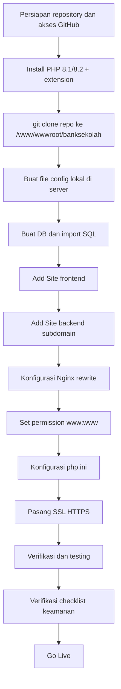

# Panduan Deployment — Bank Sekolah (Yii2 Advanced) di aaPanel

> ⚠️ **PERINGATAN KEAMANAN KRITIS — BACA SEBELUM DEPLOY**
>
> Repository ini **pernah terinfeksi webshell** di dalam folder `uploads`:
>
> - **37 file** berekstensi eksekusi (`.php`, `.phtml`, `.pht`, `.phar`, `.php4`–`.php8`, `.phps`, `.phpt`, `.blob`) ditemukan di `backend/web/uploads/school/` dan `backend/web/uploads/import/`.
> - **5 gambar polyglot** (`.jpg`/`.png`/`.gif`) yang di dalamnya disisipi payload `<?php system($_GET["c"]); ?>`.
> - Varian yang ditemukan: shell minimal, uploader (`move_uploaded_file`), file manager **NEBULA V** (auth bypass dengan hash `admin`), remote loader (`eval(file_get_contents(hex2bin(...)))` ke domain eksternal), dan obfuscated shell (penyambungan string).
> - File sudah **dibersihkan di commit `3502d824`** (file dihapus, isi `uploads` di-`.gitignore`, `.htaccess` pemblokir eksekusi ditambahkan) — **tetapi webshell masih tersimpan di git history** (commit `4a7d1883` dan sebelumnya), dan repo **sudah dipublikasikan ke GitHub**.
>
> **WAJIB dilakukan sebelum deploy ke server produksi:**
>
> 1. **Scan server lama** jika server tersebut pernah menjalankan kode ini — jangan berasumsi server bersih hanya karena repo sudah dibersihkan.
> 2. **Rotasi SEMUA kredensial**: password database, Mailchimp API key, `cookieValidationKey` (frontend & backend), kredensial admin aplikasi, SSH key, dan token GitHub (PAT).
> 3. **Audit log akses**: periksa access log Nginx/PHP untuk request mencurigakan (mis. parameter `?c=`, akses `.php` di `/uploads/`, request ke file manager).
> 4. **Pertimbangkan pembersihan git history** dengan `git filter-repo` / BFG Repo-Cleaner bila repo bersifat publik (lihat **§16.6**).
>
> Prosedur lengkap ada di **Section 16 — Hardening Keamanan Upload & Webshell** (setelah Checklist Keamanan, sebelum Troubleshooting).

Dokumen ini adalah panduan langkah demi langkah untuk men-deploy aplikasi **Bank Sekolah** (Yii2 Advanced Template) ke server yang dikelola dengan **aaPanel**, menggunakan **Nginx**, **PHP 8.1/8.2**, dan **MySQL 8.0**.

Metode deployment yang dipakai adalah **Git clone langsung dari GitHub** (`git clone` + `git pull`). Tidak ada proses upload zip/File Manager sebagai metode utama.

> **Catatan Umum**
>
> - Ganti seluruh placeholder berikut dengan nilai Anda sendiri:
>   - `domain-anda.com` → domain utama (contoh: `banksekolah.com`)
>   - `admin.domain-anda.com` → subdomain panel admin (contoh: `admin.banksekolah.com`)
>   - `/www/wwwroot/banksekolah` → direktori proyek di server
>   - `banksekolah_db` / `banksekolah_user` / `PASSWORD_KUAT_ANDA` → kredensial database produksi
>   - `<TOKEN>` → GitHub Personal Access Token (hanya untuk repo private)
> - Dokumen ini **tidak** mencakup instalasi aaPanel dari nol. Diasumsikan aaPanel sudah terpasang dan dapat diakses.
> - Jangan menjalankan `chmod 777` pada direktori apa pun. Gunakan kepemilikan `www:www` + permission `755`/`775`.

---

## 1. Ringkasan Proyek

| Item | Keterangan |
| --- | --- |
| Nama Aplikasi | Bank Sekolah |
| Framework | Yii2 **Advanced Template** (`yiisoft/yii2` **2.0.51**) |
| Versi PHP | **8.1 atau 8.2** (WAJIB) |
| Database | MySQL **8.0+** / MariaDB **10.2+** |
| Nama Database | `banksekolah_db` (buat baru di server) |
| Charset Database | `utf8mb4` (dump SQL sudah utf8mb4) |
| **Sumber Deploy** | **GitHub repo: `https://github.com/wahyudedik/bangsekolah.git` (branch `main`)** |
| Metode Deploy | `git clone` saat instalasi awal, `git pull` saat update |
| Entry Point Frontend | [`frontend/web/index.php`](frontend/web/index.php) → `YII_ENV=prod`, `YII_DEBUG=false` (ikut ter-commit) |
| Entry Point Backend | [`backend/web/index.php`](backend/web/index.php) (ikut ter-commit) |
| Document Root Frontend | `/www/wwwroot/banksekolah/frontend/web` |
| Document Root Backend | `/www/wwwroot/banksekolah/backend/web` (disarankan subdomain terpisah) |
| Dependency | `vendor/` **sudah ikut ter-commit di repo** — server **tidak perlu** `composer install` |
| File SQL | [`banksekolah_banksekolah.sql`](banksekolah_banksekolah.sql) (root proyek, ikut ter-commit) |
| File Config Lokal | `main-local.php` & `params-local.php` **di-ignore git** → **wajib dibuat manual di server** (Section 7) |
| Web Server | Nginx (aaPanel) — **tidak membaca `.htaccess`**, rewrite harus manual |

### Alur Deployment Singkat



> **Alur update berikutnya** (tanpa install ulang): lihat **Section 18** — cukup `git pull origin main` + bersihkan cache.

---

## 2. Prasyarat

### 2.1 Spesifikasi Server Minimum

| Komponen | Minimum | Rekomendasi |
| --- | --- | --- |
| CPU | 1 vCPU | 2 vCPU |
| RAM | 1 GB | 2–4 GB |
| Disk | 10 GB | 20 GB+ (untuk backup & log) |
| OS | Ubuntu 20.04 / CentOS 7 / AlmaLinux 8 | Ubuntu 22.04 / AlmaLinux 9 |

### 2.2 Versi PHP

| Versi | Status | Keterangan |
| --- | --- | --- |
| PHP ≤ 8.0 | ❌ Tidak didukung | `phpoffice/phpspreadsheet` 2.2.1 membutuhkan `^8.1` |
| **PHP 8.1** | ✅ **Direkomendasikan** | Paling stabil untuk stack ini |
| **PHP 8.2** | ✅ Didukung | Alternatif yang aman |
| PHP 8.3 / 8.4 | ⚠️ Berisiko | Hindari; kemungkinan deprecation/breaking change pada dependency lama |
| PHP CLI | ≥ 8.1 | Wajib jika menjalankan `yii` atau migration |

### 2.3 Extension PHP Wajib

Semua extension berikut harus **aktif** pada versi PHP yang dipakai:

| Kategori | Extension |
| --- | --- |
| Inti & String | `openssl`, `mbstring`, `ctype`, `iconv`, `pcre`, `json` |
| Database | `pdo`, `pdo_mysql` |
| XML / DOM | `dom`, `xml`, `xmlreader`, `xmlwriter`, `simplexml`, `libxml` |
| Arsip & File | `zip`, `zlib`, `fileinfo` |
| Gambar | `gd` (dengan **FreeType**) atau `imagick` |
| HTTP | `curl` |

> **Penting:** `gd` wajib dikompilasi dengan dukungan **FreeType** (`--with-freetype`) karena digunakan untuk captcha / manipulasi gambar. Jika tidak tersedia, gunakan `imagick`.

### 2.4 Kebutuhan Git

| Komponen | Keterangan |
| --- | --- |
| `git` di server | Wajib. Cek dengan `git --version` (minimal git 2.x) |
| Akses ke repo | Repo public: tanpa kredensial. Repo private: Personal Access Token (PAT) atau SSH deploy key |
| Akses internet server | Dibutuhkan agar server dapat `git clone` / `git pull` dari `github.com` |

### 2.5 Database

- MySQL **8.0+** atau MariaDB **10.2+** (dump dibuat dengan MySQL 8.0.46).
- Charset `utf8mb4` dan collation `utf8mb4_general_ci` (atau `utf8mb4_unicode_ci`).

---

## 3. Persiapan Repository & Konfigurasi Lokal

Section ini menggantikan langkah "persiapan sebelum upload". **Tidak ada lagi langkah hapus file berbahaya atau edit file tracked secara manual** — seluruh perbaikan keamanan sudah masuk ke repository dan diverifikasi di server (Section 15).

### 3.1 Yang Sudah Ditangani di Repository

Jangan mengulang langkah-langkah berikut secara manual di server, karena sudah beres di repo (cukup **diverifikasi**):

| Item | Status di repo | Cara verifikasi |
| --- | --- | --- |
| `backend/web/db.php` (Adminer) | Sudah **dihapus** | `git ls-files \| grep db.php` → tidak ada hasil |
| `backend/web/info.php` (phpinfo) | Sudah **dihapus** | `git ls-files \| grep info.php` → tidak ada hasil |
| `frontend/controllers/DatabaseController.php` | **Dipertahankan + diberi `AccessControl`** (hanya user login/admin) | lihat [`frontend/controllers/DatabaseController.php`](frontend/controllers/DatabaseController.php:16) |
| API key Mailchimp hardcoded | Dipindah ke `params` → [`common/config/params.php`](common/config/params.php:7), dibaca via `Yii::$app->params['mailchimpApiKey']` | lihat [`frontend/controllers/SubscribeController.php`](frontend/controllers/SubscribeController.php:82) |
| Modul `gii` di backend | Sudah **dikomentari** di [`backend/config/main.php`](backend/config/main.php:14) | `grep -n "gii" backend/config/main.php` |
| `vendor/` | **Ikut ter-commit** (tidak di-ignore) | `git ls-files vendor/autoload.php` |
| Entry point `web/index.php` | **Ikut ter-commit** | `git ls-files frontend/web/index.php backend/web/index.php` |
| `.gitignore` | Mengecualikan `banksekolahgit/`, `git.zip`, `error_log`, `*.log`, `desktop.ini`, `.user.ini`, dan semua `main-local.php` / `params-local.php` | lihat [`.gitignore`](.gitignore:38) |

### 3.2 Konsekuensi Penting: Config Lokal Tidak Ikut Clone

Karena `.gitignore` mengecualikan file config lokal, setelah `git clone` file berikut **TIDAK ADA** di server:

```text
common/config/main-local.php        # kredensial DB (WAJIB)
common/config/params-local.php      # params privat (WAJIB, karena di-require main.php)
backend/config/main-local.php       # cookieValidationKey backend (WAJIB)
frontend/config/main-local.php      # cookieValidationKey frontend (WAJIB)
console/config/main-local.php       # config console (WAJIB untuk ./yii)
```

Selain itu, file console runner `/yii` di root proyek juga di-ignore git (`.gitignore` baris `/yii`), sehingga harus dibuat dari template.

> **Kesimpulan:** setelah clone, **wajib membuat file config lokal di server** sebelum aplikasi bisa jalan. Langkah lengkapnya ada di **Section 7**. Jangan menjalankan `php init --env=Production` (lihat peringatan di Section 7.6).

### 3.3 Hal yang Tetap Disiapkan Sebelum Deploy

| Persiapan | Keterangan |
| --- | --- |
| Akses repo GitHub | Public: langsung. Private: siapkan PAT / SSH deploy key |
| Domain & DNS | Arahkan `domain-anda.com` dan `admin.domain-anda.com` ke IP server |
| Kredensial DB produksi | Siapkan `banksekolah_db`, `banksekolah_user`, password kuat |
| Nilai `cookieValidationKey` | Generate 2 nilai berbeda (frontend & backend) |
| Secret Mailchimp (jika dipakai) | Taruh di `common/config/params-local.php`, **bukan** di file tracked |

### 3.4 Amankan API Key Mailchimp (di luar repo)

Nilai `mailchimpApiKey` saat ini ada di file tracked [`common/config/params.php`](common/config/params.php:7). Untuk produksi:

1. **Revoke** key yang pernah ter-commit di dashboard Mailchimp, buat key baru.
2. Isi key baru di `common/config/params-local.php` (di-ignore git), bukan di `params.php`:

```php
<?php
return [
    'mailchimpApiKey' => 'KEY_BARU_DARI_DASHBOARD',
];
```

1. Jika fitur Mailchimp tidak dipakai, cukup revoke key lama (method tidak perlu dipanggil).

### 3.5 Jangan Edit File Tracked di Server

Semua file yang **ikut ter-commit** (`common/config/bootstrap.php`, `backend/config/main.php`, entry point, dll.) **jangan diedit langsung di server**, karena akan menyebabkan konflik saat `git pull`.

| Kebutuhan | Cara aman (git-friendly) |
| --- | --- |
| Kredensial DB | `common/config/main-local.php` (ignored) |
| Alias `@fronturl` / `@backurl` | Override di `common/config/main-local.php` → key `aliases` (Section 7.3) |
| `cookieValidationKey` | `frontend | backend/config/main-local.php` (ignored) |
| Secret API | `common/config/params-local.php` (ignored) |

---

## 4. Instalasi aaPanel

Diasumsikan aaPanel sudah terpasang dan login panel berhasil.

### 4.1 Paket yang Harus Diinstall dari App Store

| No | Paket | Versi / Catatan |
| --- | --- | --- |
| 1 | **Nginx** | 1.22+ (wajib; bukan Apache) |
| 2 | **MySQL** | **8.0** (minimal) |
| 3 | **PHP** | **8.1** atau **8.2** |
| 4 | **phpMyAdmin** | Untuk import SQL & verifikasi tabel |
| 5 | (Opsional) Redis | Untuk cache/session jika dibutuhkan |
| 6 | (Opsional) Fail2ban | Proteksi brute-force login |

### 4.2 Langkah Instalasi Paket

1. Buka **aaPanel → App Store**.
2. Cari `Nginx` → **Install** (pilih versi stabil terbaru).
3. Cari `MySQL` → **Install** versi **8.0**.
4. Cari `PHP` → **Install** versi **8.1** (atau 8.2).
5. Cari `phpMyAdmin` → **Install**.
6. Tunggu seluruh proses kompilasi selesai (bisa memakan waktu cukup lama pada server kecil).
7. Verifikasi melalui terminal server:

```bash
nginx -v
mysql --version
php -v
git --version
```

> **Catatan:** aaPanel menggunakan **satu PHP-FPM pool per versi**. Semua situs harus diarahkan ke versi PHP yang sama (`8.1`/`8.2`) agar konsisten.

---

## 5. Install PHP 8.1/8.2 + Extension

### 5.1 Install Extension via GUI aaPanel

1. Buka **App Store → PHP-8.1** (atau `PHP-8.2`) → klik **Setting**.
2. Masuk tab **Install extension**.
3. Install extension berikut satu per satu (status harus **On** / hijau):

```text
openssl, pdo, pdo_mysql, mbstring, ctype, dom, xml, xmlreader, xmlwriter,
simplexml, libxml, zip, zlib, fileinfo, iconv, gd, curl, json, pcre
```

1. Untuk **gd**, klik **Setting** pada baris `gd` dan pastikan **FreeType** terpasang. Jika tidak bisa, install `imagick` sebagai alternatif.
2. Klik **Reload** PHP-FPM setelah semua extension aktif.

### 5.2 Verifikasi Extension via CLI

```bash
# Ganti 81 dengan versi PHP yang dipakai (81 / 82)
/www/server/php/81/bin/php -m | sort
```

Pastikan output memuat: `openssl`, `pdo_mysql`, `mbstring`, `dom`, `zip`, `fileinfo`, `gd`, `curl`, `xml`, `simplexml`.

Cek juga dukungan FreeType pada GD:

```bash
/www/server/php/81/bin/php -r "print_r(gd_info());" | grep -i freetype
```

### 5.3 Samakan PHP CLI

```bash
# Cek versi CLI default
php -v

# Jika CLI masih versi lama, arahkan ulang (opsional)
ln -sf /www/server/php/81/bin/php /usr/bin/php
php -v
```

> PHP CLI ≥ 8.1 diperlukan jika Anda menjalankan `./yii migrate` atau perintah console lain. Jika restore dari SQL dump, langkah ini boleh dilewati.

---

## 6. Clone Repository dari GitHub

### 6.1 Prasyarat

```bash
# 1. Pastikan git tersedia
git --version
# bila belum ada (Debian/Ubuntu):
# apt install -y git
# bila belum ada (CentOS/AlmaLinux):
# dnf install -y git

# 2. Pastikan server dapat menjangkau GitHub
curl -I https://github.com
```

Siapkan juga akses repo:

| Tipe repo | Kredensial |
| --- | --- |
| Public | Tidak perlu kredensial |
| Private | Personal Access Token (PAT) dengan scope `repo`, **atau** SSH deploy key |

### 6.2 Clone ke Direktori Tujuan

Direktori tujuan: `/www/wwwroot/banksekolah`

```bash
cd /www/wwwroot
git clone https://github.com/wahyudedik/bangsekolah.git banksekolah
cd banksekolah
```

Pastikan berada di branch `main`:

```bash
git branch --show-current     # harus: main
git remote -v                 # origin -> https://github.com/wahyudedik/bangsekolah.git
git log --oneline -1
```

### 6.3 Repo Private — Gunakan Personal Access Token (PAT)

**Opsi A — Token langsung pada URL clone**

```bash
cd /www/wwwroot
git clone https://<TOKEN>@github.com/wahyudedik/bangsekolah.git banksekolah
cd banksekolah

# PENTING: hapus token dari konfigurasi remote setelah clone berhasil
git remote set-url origin https://github.com/wahyudedik/bangsekolah.git
git remote -v
```

**Opsi B — Simpan kredensial via credential helper**

```bash
# Simpan kredensial di ~/.git-credentials (file di luar repo)
git config --global credential.helper store
# amankan file
chmod 600 ~/.git-credentials

cd /www/wwwroot
git clone https://github.com/wahyudedik/bangsekolah.git banksekolah
# git akan menanyakan username & password (isi password = PAT)
```

**Opsi C — SSH deploy key (repo private, tanpa token di URL)**

```bash
# di server, sebagai user yang menjalankan git (root)
ssh-keygen -t ed25519 -C "deploy@server" -f ~/.ssh/id_ed25519 -N ""
cat ~/.ssh/id_ed25519.pub
# tambahkan public key tersebut di GitHub: Repo → Settings → Deploy keys (read-only cukup)

ssh -T git@github.com   # harus muncul "successfully authenticated"

cd /www/wwwroot
git clone git@github.com:wahyudedik/bangsekolah.git banksekolah
```

> **Keamanan token:**
>
> - **Jangan** menulis token ke file apa pun di dalam repo (mis. `README.md`, script deploy, atau config yang ikut ter-commit).
> - Setelah clone, pastikan remote tidak lagi menyimpan token: `git remote -v` harus menampilkan URL polos tanpa `<TOKEN>@`.
> - Simpan kredensial hanya di `~/.git-credentials` (permission `600`) atau SSH key di `~/.ssh` (permission `600`).
> - Jika token pernah bocor, **revoke** di GitHub → Settings → Developer settings → Tokens.

### 6.4 Verifikasi Hasil Clone

```bash
cd /www/wwwroot/banksekolah
ls -la
```

Struktur folder tujuan yang diharapkan:

```text
/www/wwwroot/banksekolah/
├── .git/                  <-- WAJIB ADA (untuk update via git pull)
├── backend/
├── common/
├── console/
├── environments/
├── frontend/
├── vendor/                <-- WAJIB ADA, sudah ikut repo
├── composer.json
├── composer.lock
├── banksekolah_banksekolah.sql
└── ...
```

Periksa file kritis yang **harus** ada hasil clone:

```bash
ls -l vendor/autoload.php frontend/web/index.php backend/web/index.php banksekolah_banksekolah.sql
git ls-files vendor/autoload.php frontend/web/index.php backend/web/index.php
```

Semua perintah di atas harus menampilkan file (tidak “No such file or directory”).

### 6.5 `vendor/` Sudah Ada — Tidak Perlu `composer install`

- Folder `vendor/` **sudah di-commit** ke repository, sehingga hasil `git clone` langsung lengkap.
- **Tidak perlu** menjalankan `composer install` di server.
- Server **tidak wajib** punya Composer.
- Opsional (hanya jika memang ingin memperbarui dependency, mis. `composer.json`/`composer.lock` berubah):

```bash
cd /www/wwwroot/banksekolah
composer install --no-dev --optimize-autoloader
```

> Jangan menjalankan `composer update` di produksi — dapat mengubah versi dependency secara tak terduga.

### 6.6 Jangan Clone di Dalam Folder Situs Web

Clone **harus** di `/www/wwwroot/banksekolah` (satu level di atas `frontend/web` dan `backend/web`). Jangan meng-clone ke dalam `frontend/web` atau `backend/web`, karena seluruh source code akan terekspos publik.

### 6.7 Alternatif Darurat (Bukan Metode Utama)

Jika `git` benar-benar tidak tersedia dan tidak bisa diinstal, barulah boleh memakai **File Manager aaPanel** untuk meng-upload arsip source (`.zip`) lalu **Unzip**. Konsekuensinya:

- Tidak ada `.git/`, sehingga update berikutnya harus manual.
- File `main-local.php` tetap harus dibuat manual (Section 7).
- Pastikan hasil unzip **tidak** menaruh folder bersarang ganda (mis. `banksekolah/banksekolah/`).

Metode utama tetap **git clone**.

---

## 7. Membuat File Konfigurasi Lokal Setelah Clone

Section ini **wajib** dijalankan setelah `git clone`, karena semua `main-local.php` / `params-local.php` di-ignore git sehingga tidak ikut ter-clone. Tanpa file ini, aplikasi akan gagal start (fatal error saat `require`).

### 7.1 Ringkasan File yang Harus Ada

| File | Isi wajib | Di-require oleh |
| --- | --- | --- |
| `common/config/main-local.php` | Kredensial `db`, override `aliases`, `mailer` | frontend, backend, console entry point |
| `common/config/params-local.php` | Params privat (review key Mailchimp) | `common/config/main.php` via params merge |
| `backend/config/main-local.php` | `cookieValidationKey` backend | `backend/web/index.php` |
| `frontend/config/main-local.php` | `cookieValidationKey` frontend | `frontend/web/index.php` |
| `console/config/main-local.php` | Config console (boleh kosong) | `yii` console runner |

### 7.2 Cara Tercepat — Copy dari Template `environments/prod`

```bash
cd /www/wwwroot/banksekolah

# Config utama
cp environments/prod/common/config/main-local.php   common/config/main-local.php
cp environments/prod/common/config/params-local.php common/config/params-local.php
cp environments/prod/backend/config/main-local.php  backend/config/main-local.php
cp environments/prod/frontend/config/main-local.php frontend/config/main-local.php
cp environments/prod/console/config/main-local.php  console/config/main-local.php

# Params lokal per aplikasi (template kosong)
cp environments/prod/backend/config/params-local.php  backend/config/params-local.php
cp environments/prod/frontend/config/params-local.php frontend/config/params-local.php
cp environments/prod/console/config/params-local.php  console/config/params-local.php

# Console runner /yii (di-ignore git, jadi tidak ada setelah clone)
cp environments/prod/yii yii
chmod 755 yii
```

Verifikasi file terbentuk:

```bash
ls -l common/config/main-local.php common/config/params-local.php \
      backend/config/main-local.php frontend/config/main-local.php \
      console/config/main-local.php yii
```

### 7.3 Isi `common/config/main-local.php` (Kredensial DB)

Template dari `environments/prod` masih berisi placeholder `yii2advanced` / `root`. Ganti menjadi:

```php
<?php
return [
    // Override alias (JANGAN edit common/config/bootstrap.php — file itu tracked)
    'aliases' => [
        '@fronturl' => 'https://domain-anda.com',
        '@backurl'  => 'https://admin.domain-anda.com',
    ],
    'components' => [
        'db' => [
            'class' => 'yii\db\Connection',
            'dsn' => 'mysql:host=localhost;dbname=banksekolah_db',
            'username' => 'banksekolah_user',
            'password' => 'PASSWORD_KUAT_ANDA',
            'charset' => 'utf8mb4',
            'enableSchemaCache' => true,
            'schemaCacheDuration' => 3600,
            'schemaCache' => 'cache',
        ],
        'mailer' => [
            'class' => 'yii\swiftmailer\Mailer',
            'viewPath' => '@common/mail',
        ],
    ],
];
```

| Parameter | Nilai |
| --- | --- |
| host | `localhost` (atau `127.0.0.1`) |
| dbname | `banksekolah_db` |
| username | `banksekolah_user` |
| password | `PASSWORD_KUAT_ANDA` |
| charset | `utf8mb4` |

> **Wajib:** `charset` harus **`utf8mb4`**, bukan `utf8`, agar emoji dan karakter 4-byte tersimpan benar.
>
> Jika database belum dibuat, lakukan Section 8.1 lebih dulu, lalu kembali mengisi nilai di atas.

### 7.4 Isi `common/config/params-local.php`

Boleh kosong (tetap wajib ada karena di-`require`):

```php
<?php
return [];
```

Isi hanya bila perlu menimpa params publik, misalnya key Mailchimp produksi (Section 3.4):

```php
<?php
return [
    'mailchimpApiKey' => 'KEY_BARU_DARI_DASHBOARD',
];
```

### 7.5 Isi `cookieValidationKey` Frontend & Backend

Generate **dua** key berbeda di server:

```bash
openssl rand -base64 32
openssl rand -base64 32
```

`frontend/config/main-local.php`:

```php
<?php
return [
    'components' => [
        'request' => [
            'cookieValidationKey' => 'KEY_FRONTEND_HASIL_GENERATE_1',
        ],
    ],
];
```

`backend/config/main-local.php`:

```php
<?php
return [
    'components' => [
        'request' => [
            'cookieValidationKey' => 'KEY_BACKEND_HASIL_GENERATE_2',
        ],
    ],
];
```

> **WAJIB:** nilai frontend dan backend **harus berbeda**. Jika kosong atau sama, sesi/login akan bermasalah (login gagal, logout sendiri, atau konflik cookie).

`console/config/main-local.php` cukup berisi:

```php
<?php
return [];
```

### 7.6 JANGAN Jalankan `php init --env=Production`

> ⚠️ **Risiko:** `php init --env=Production` akan **MENIMPA** config di atas dengan placeholder template (`yii2advanced` / `root`), sehingga aplikasi gagal konek database dan key kembali kosong. Selain itu `init` juga menimpa entry point yang sudah benar di repo.

**Buat file config lokal secara manual** (langkah 7.2–7.5), jangan pakai `init`.

### 7.7 Cek Syntax & Permission File Config

```bash
cd /www/wwwroot/banksekolah

# Cek syntax PHP (harus tidak ada output error)
php -l common/config/main-local.php
php -l common/config/params-local.php
php -l frontend/config/main-local.php
php -l backend/config/main-local.php
php -l console/config/main-local.php

# Permission: file config tidak boleh world-writable
chown -R www:www common/config frontend/config backend/config console/config
chmod 644 common/config/main-local.php common/config/params-local.php \
          frontend/config/main-local.php frontend/config/params-local.php \
          backend/config/main-local.php backend/config/params-local.php \
          console/config/main-local.php console/config/params-local.php
chmod 755 yii
```

### 7.8 Pastikan Config Lokal Tidak Masuk Git

```bash
cd /www/wwwroot/banksekolah
git status --short
# HARUS kosong (file config lokal sudah di-ignore)
```

Jika file config lokal muncul sebagai untracked, **jangan** `git add` — periksa kembali apakah `.gitignore` masih berisi entri `main-local.php` / `params-local.php`.

---

## 8. Buat Database & Import SQL

### 8.1 Buat Database dan User di aaPanel

1. Buka **Databases → Add Database**.
2. Isi:
   - **Database name:** `banksekolah_db`
   - **Username:** `banksekolah_user`
   - **Password:** `PASSWORD_KUAT_ANDA`
   - **Charset:** `utf8mb4`
   - **Access:** `localhost` (hanya lokal)
3. Klik **Submit**, lalu catat kredensialnya.
4. Samakan nilai tersebut dengan `common/config/main-local.php` (Section 7.3).

### 8.2 Import SQL via phpMyAdmin

1. Buka **phpMyAdmin** dari aaPanel.
2. Pilih database `banksekolah_db`.
3. Tab **Import** → **Choose File** → pilih `banksekolah_banksekolah.sql` (ada di root proyek hasil clone).
4. Pastikan **Character set of the file:** `utf8mb4`.
5. Klik **Go** dan tunggu hingga selesai (±99.160 baris).

### 8.3 Import SQL via CLI (Lebih Cepat & Stabil)

```bash
cd /www/wwwroot/banksekolah

mysql -u banksekolah_user -p banksekolah_db \
  --default-character-set=utf8mb4 \
  < banksekolah_banksekolah.sql
```

Atau sebagai root:

```bash
mysql -u root -p banksekolah_db --default-character-set=utf8mb4 < banksekolah_banksekolah.sql
```

### 8.4 Verifikasi Hasil Import

```bash
mysql -u banksekolah_user -p banksekolah_db -e "SHOW TABLES;" | wc -l
mysql -u banksekolah_user -p banksekolah_db -e "SHOW CREATE DATABASE banksekolah_db\G"
```

Pastikan charset database tampil `utf8mb4`.

### 8.5 Jangan Gunakan User `root`

> **Jangan** gunakan user `root` untuk aplikasi. Buat user khusus dengan hak akses hanya pada database aplikasi.

---

## 9. Buat Website di aaPanel

### 9.1 Situs Frontend (Domain Utama)

1. Buka **Website → Add Site**.
2. Isi:
   - **Domain:** `domain-anda.com`
   - **Root directory:** `/www/wwwroot/banksekolah/frontend/web`
   - **FTP:** tidak perlu
   - **Database:** tidak perlu (sudah dibuat)
   - **PHP version:** `8.1` (atau `8.2`)
3. Klik **Submit**.

> **KRITIS:** Document root **WAJIB** menunjuk ke `frontend/web`, **bukan** ke root proyek. Jika salah, seluruh source code (`config`, `vendor`, `.sql`) dapat diakses publik.

### 9.2 Situs Backend (Subdomain Admin)

Disarankan memakai subdomain terpisah agar panel admin terisolasi:

1. **Website → Add Site**.
2. Isi:
   - **Domain:** `admin.domain-anda.com`
   - **Root directory:** `/www/wwwroot/banksekolah/backend/web`
   - **PHP version:** `8.1` (sama dengan frontend)
3. Klik **Submit**.
4. Buat DNS record `A` untuk `admin.domain-anda.com` → IP server.

### 9.3 Alternatif: Backend di Sub-path

Jika tidak memungkinkan subdomain, akses backend via `https://domain-anda.com/backend/web/...`. Namun konfigurasi Nginx harus ditambahkan manual (lihat Section 10.3), dan risiko kebocoran file lebih tinggi.

### 9.4 Cek Konfigurasi Site

```bash
ls -l /www/server/panel/vhost/nginx/
```

Akan terlihat file seperti `domain-anda.com.conf` dan `admin.domain-anda.com.conf`.

---

## 10. Konfigurasi Nginx Rewrite

> **PENTING:** aaPanel (Nginx) **tidak membaca** `.htaccess` maupun `.user.ini`. Semua aturan rewrite Apache di [`frontend/web/.htaccess`](frontend/web/.htaccess) **harus** diterjemahkan ke konfigurasi Nginx. [`backend/web/.htaccess`](backend/web/.htaccess) seluruh isinya dikomentari, dan `urlManager` backend juga dinonaktifkan.

### 10.1 Konfigurasi Frontend

Buka **Website → domain-anda.com → Config** (atau edit `/www/server/panel/vhost/nginx/domain-anda.com.conf`). Pastikan blok `server` berisi:

```nginx
server {
    listen 80;
    listen 443 ssl http2;
    server_name domain-anda.com www.domain-anda.com;

    root /www/wwwroot/banksekolah/frontend/web;
    index index.php index.html;

    # ---- Yii2 pretty URL ----
    location / {
        try_files $uri $uri/ /index.php?$args;
    }

    # ---- Blokir akses langsung ke file sensitif ----
    location ~* ^/(vendor|common|console|backend|environments|database)/ {
        deny all;
        return 404;
    }
    location ~* \.(sql|log|ini|bak|md|json|lock)$ {
        deny all;
        return 404;
    }
    location ~ ^/\.(git|user\.ini) { deny all; return 404; }

    # ---- Static assets: cache panjang ----
    location ^~ /assets/ {
        expires 30d;
        add_header Cache-Control "public, max-age=2592000";
        try_files $uri =404;
    }
    location ~* \.(css|js|jpg|jpeg|png|gif|svg|webp|ico|woff2?|ttf|eot)$ {
        expires 30d;
        access_log off;
    }

    # ---- Blokir eksekusi script di uploads (WAJIB - lihat Section 16.3) ----
    location ~* ^/uploads/.*\.(php|phtml|pht|phar|php[0-9]|phps|inc|cgi|pl|py|sh|blob)$ {
        deny all;
        return 403;
    }

    # ---- Upload frontend ----
    location ^~ /uploads/ {
        location ~ \.php$ {
            deny all;
            return 403;
        }
        try_files $uri =404;
    }

    # ---- PHP ----
    include enable-php-81.conf;
}
```

> Sesuaikan `include enable-php-81.conf;` dengan versi PHP Anda (`enable-php-82.conf` untuk PHP 8.2). aaPanel menyediakan file include ini di `/www/server/nginx/conf/`.
>
> **WAJIB:** blok `location` pemblokir eksekusi di `/uploads/` harus tetap berada **sebelum** `include enable-php-81.conf;`. Penjelasan lengkap & cara uji ada di **Section 16.3**.

### 10.2 Konfigurasi Backend

Untuk subdomain `admin.domain-anda.com` (root: `backend/web`):

```nginx
server {
    listen 80;
    listen 443 ssl http2;
    server_name admin.domain-anda.com;

    root /www/wwwroot/banksekolah/backend/web;
    index index.php index.html;

    # Backend menggunakan index.php?r=... (pretty URL OFF)
    location / {
        try_files $uri $uri/ /index.php?$args;
    }

    # Blokir file sensitif
    location ~* \.(sql|log|ini|bak|md|json|lock)$ {
        deny all;
        return 404;
    }

    # Assets backend (hasil publish Yii)
    location ^~ /assets/ {
        expires 30d;
        add_header Cache-Control "public, max-age=2592000";
        try_files $uri =404;
    }

    # Blokir eksekusi script di uploads (WAJIB - lihat Section 16.3)
    location ~* ^/uploads/.*\.(php|phtml|pht|phar|php[0-9]|phps|inc|cgi|pl|py|sh|blob)$ {
        deny all;
        return 403;
    }

    # Upload backend
    location ^~ /uploads/ {
        location ~ \.php$ {
            deny all;
            return 403;
        }
        try_files $uri =404;
    }

    include enable-php-81.conf;
}
```

> **Catatan URL Backend:** karena `urlManager` di [`backend/config/main.php`](backend/config/main.php) dikomentari, backend diakses dengan format:
>
> - `https://admin.domain-anda.com/`
> - `https://admin.domain-anda.com/index.php?r=site/login`
>
> Jika menginginkan `https://admin.domain-anda.com/site/login`, aktifkan `urlManager` di backend:

```php
'urlManager' => [
    'enablePrettyUrl' => true,
    'showScriptName' => false,
    'rules' => [],
],
```

Setelah itu rewrite Nginx di atas akan otomatis menangani pretty URL.

### 10.3 Opsional: Backend di Sub-path

Jika backend diakses via `https://domain-anda.com/backend/web/`, tambahkan blok berikut **di dalam** `server` frontend:

```nginx
location /backend/web/ {
    alias /www/wwwroot/banksekolah/backend/web/;
    index index.php;
    try_files $uri $uri/ /backend/web/index.php?$args;
}
```

> Pendekatan ini kurang aman dan lebih sulit di-maintain. Subdomain tetap direkomendasikan.

### 10.4 Test & Reload Nginx

```bash
nginx -t
nginx -s reload
```

Jika `nginx -t` gagal, periksa pesan error baris berapa yang bermasalah.

---

## 11. Set Permission & Ownership

### 11.1 Kepemilikan

Web server aaPanel berjalan sebagai user `www`:

```bash
cd /www/wwwroot/banksekolah

# Set owner ke www untuk seluruh file kerja, KECUALI folder .git
# (folder .git tetap milik root agar `git pull` sebagai root selalu berhasil)
find . -maxdepth 1 -mindepth 1 ! -name '.git' -exec chown -R www:www {} +
chown -R root:root .git
```

> **Catatan git:** memisahkan kepemilikan `.git` (root) dari file kerja (`www`) membuat `git pull` selalu lancar. Jika tetap muncul error `insufficient permission`, lihat Section 18.3.

### 11.2 Permission Direktori Writable

Yii2 membutuhkan direktori berikut **dapat ditulis** oleh `www`:

| Direktori | Kegunaan |
| --- | --- |
| `backend/runtime` | Log, cache backend |
| `frontend/runtime` | Log, cache frontend |
| `console/runtime` | Log console |
| `backend/web/assets` | Hasil publish asset backend |
| `frontend/web/assets` | Hasil publish asset frontend |
| `backend/web/uploads` | File upload admin |
| `frontend/web/uploads` | File upload frontend |

Perintah:

```bash
cd /www/wwwroot/banksekolah

# Pastikan direktori ada (folder runtime/assets/uploads TIDAK ikut di-commit)
mkdir -p backend/runtime frontend/runtime console/runtime \
         backend/web/assets frontend/web/assets \
         backend/web/uploads frontend/web/uploads

# Permission standar: folder 755, file 644
find backend/runtime frontend/runtime console/runtime \
     backend/web/assets frontend/web/assets \
     backend/web/uploads frontend/web/uploads \
     -type d -exec chmod 755 {} \;
find backend/runtime frontend/runtime console/runtime \
     backend/web/assets frontend/web/assets \
     backend/web/uploads frontend/web/uploads \
     -type f -exec chmod 644 {} \;

# Beri group-write pada direktori writable
chmod -R g+w backend/runtime frontend/runtime console/runtime \
             backend/web/assets frontend/web/assets \
             backend/web/uploads frontend/web/uploads

chown -R www:www backend/runtime frontend/runtime console/runtime \
                   backend/web/assets frontend/web/assets \
                   backend/web/uploads frontend/web/uploads
```

### 11.3 Subfolder Upload

Analisis menyebutkan subfolder upload: `banner`, `media`, `pages`, `posts`, `category`, `database`, `import`. Pada repository saat ini yang terlihat adalah `import/`, `school/`, `user/`. Pastikan **semua** subfolder yang benar-benar ada dapat ditulis, dan buat subfolder yang dibutuhkan aplikasi:

```bash
cd /www/wwwroot/banksekolah
mkdir -p backend/web/uploads/{banner,media,pages,posts,category,database,import}
chown -R www:www backend/web/uploads
chmod -R 755 backend/web/uploads && chmod -R g+w backend/web/uploads
```

### 11.4 File Console

```bash
chmod 755 /www/wwwroot/banksekolah/yii
```

### 11.5 JANGAN Gunakan 777

```bash
# ❌ JANGAN LAKUKAN INI
# chmod -R 777 backend frontend
```

`777` membuat file dapat dieksekusi/ditulis oleh siapa pun dan merupakan risiko keamanan serius. Gunakan `755` (folder) / `644` (file) dengan owner `www:www`, dan `775` hanya bila benar-benar butuh group-write.

### 11.6 Verifikasi

```bash
cd /www/wwwroot/banksekolah
ls -ld backend/runtime frontend/runtime backend/web/assets frontend/web/assets
sudo -u www test -w backend/web/assets && echo "assets writable OK"
```

---

## 12. Konfigurasi PHP (php.ini)

### 12.1 Setting yang Disarankan

| Directive | Nilai | Alasan |
| --- | --- | --- |
| `display_errors` | `Off` | Cegah bocornya path/stack trace ke publik |
| `log_errors` | `On` | Error tetap tercatat di log |
| `memory_limit` | `256M` | Import Excel / generate PDF |
| `max_execution_time` | `300` | Proses import & report berat |
| `max_input_vars` | `3000` | Form dengan banyak field |
| `upload_max_filesize` | `50M` | Upload Excel/gambar |
| `post_max_size` | `50M` | Harus ≥ `upload_max_filesize` |
| `max_file_uploads` | `20` | Upload multi-file |
| `session.save_path` | `/tmp` | Path writable & cepat |
| `expose_php` | `Off` | Sembunyikan versi PHP dari header |
| `allow_url_include` | `Off` | Cegah RFI |
| `allow_url_fopen` | `On` | Dibutuhkan beberapa library |
| `date.timezone` | `Asia/Jakarta` | Konsistensi waktu |
| `opcache.enable` | `1` | Performa |
| `opcache.validate_timestamps` | `1` | Perubahan file langsung terdeteksi |
| `post_max_size` & `upload_max_filesize` | sama | Hindari upload terpotong diam-diam |

### 12.2 Cara Edit di aaPanel

1. **App Store → PHP-8.1 → Setting**.
2. Tab **Configuration** (atau **Config**).
3. Ubah nilai pada editor, lalu **Save**.
4. Klik **Reload** pada PHP-FPM.

### 12.3 Edit via CLI

```bash
# Backup dulu
cp /www/server/php/81/etc/php.ini /www/server/php/81/etc/php.ini.bak

# Edit
nano /www/server/php/81/etc/php.ini
```

Tambahkan/ubah baris berikut:

```ini
display_errors = Off
log_errors = On
error_log = /www/wwwroot/banksekolah/frontend/runtime/php_error.log

memory_limit = 256M
max_execution_time = 300
max_input_vars = 3000
upload_max_filesize = 50M
post_max_size = 50M
max_file_uploads = 20

session.save_path = "/tmp"
session.gc_maxlifetime = 1440

expose_php = Off
allow_url_include = Off
date.timezone = Asia/Jakarta

opcache.enable = 1
opcache.memory_consumption = 128
opcache.max_accelerated_files = 10000
opcache.validate_timestamps = 1
```

Reload:

```bash
/etc/init.d/php-fpm-81 reload
# atau
systemctl reload php-fpm-81
```

### 12.4 Verifikasi

```bash
/www/server/php/81/bin/php -i | grep -E "memory_limit|upload_max_filesize|post_max_size|display_errors"
```

> **Catatan:** folder log (`frontend/runtime`, `backend/runtime`) harus writable oleh `www`, jika tidak PHP-FPM gagal menulis log.

---

## 13. Verifikasi & Testing

### 13.1 Cek Akses Frontend

```bash
curl -I https://domain-anda.com
curl -s https://domain-anda.com | head -30
```

Indikator sukses: HTTP `200`, halaman beranda tampil, tidak ada error PHP.

### 13.2 Cek Akses Backend

```bash
curl -I https://admin.domain-anda.com/
curl -I "https://admin.domain-anda.com/index.php?r=site/login"
```

Halaman login backend harus muncul.

### 13.3 Cek Runtime & Log

```bash
ls -la /www/wwwroot/banksekolah/frontend/runtime/logs/
ls -la /www/wwwroot/banksekolah/backend/runtime/logs/
tail -n 50 /www/wwwroot/banksekolah/frontend/runtime/logs/app.log
tail -n 50 /www/wwwroot/banksekolah/backend/runtime/logs/app.log
```

Jika terjadi error 500 tanpa tampilan, error detail ada di file ini.

### 13.4 Cek Assets Ter-generate

```bash
ls -la /www/wwwroot/banksekolah/frontend/web/assets/
ls -la /www/wwwroot/banksekolah/backend/web/assets/
```

Yii akan membuat folder hash (contoh `a1b2c3d4/`) saat halaman pertama dimuat. Jika folder kosong dan halaman blank, biasanya masalah permission.

```bash
curl -I https://domain-anda.com/assets/
```

### 13.5 Cek Koneksi Database

```bash
mysql -u banksekolah_user -p banksekolah_db -e "SELECT COUNT(*) FROM information_schema.tables WHERE table_schema='banksekolah_db';"
```

Uji via CLI Yii (paling meyakinkan, menggunakan config yang sama dengan aplikasi):

```bash
cd /www/wwwroot/banksekolah
./yii help 2>&1 | head -5
./yii migrate/status --interactive=0 2>&1 | head -20
```

Jika perintah `./yii` berjalan tanpa fatal error, berarti `main-local.php` + `params-local.php` + `vendor/` sudah benar.

### 13.6 Cek Permission

```bash
sudo -u www test -w /www/wwwroot/banksekolah/frontend/runtime && echo "frontend runtime OK"
sudo -u www test -w /www/wwwroot/banksekolah/frontend/web/assets && echo "frontend assets OK"
sudo -u www test -w /www/wwwroot/banksekolah/backend/runtime && echo "backend runtime OK"
sudo -u www test -w /www/wwwroot/banksekolah/backend/web/uploads && echo "backend uploads OK"
```

### 13.7 Cek Halaman Sensitif Tertutup

```bash
curl -I https://domain-anda.com/backend/web/db.php              # harus 404/403
curl -I https://admin.domain-anda.com/info.php                  # harus 404/403
curl -I https://domain-anda.com/banksekolah_banksekolah.sql     # harus 404
curl -I https://domain-anda.com/.git/config                     # harus 404/403
```

> `db.php` dan `info.php` memang sudah tidak ada di repo, jadi `404` adalah hasil yang benar.

### 13.8 Smoke Test Fungsional

| Fitur | Yang Diuji |
| --- | --- |
| Login backend | Berhasil masuk dengan user admin |
| CRUD siswa/guru | Simpan, edit, hapus |
| Upload foto | File tersimpan di `backend/web/uploads` |
| Import Excel | File besar 10–20 MB berhasil |
| Export PDF | PDF ter-generate |
| Menu frontend | Semua link tidak 404 |
| Login frontend | Sesi bertahan setelah refresh |

---

## 14. SSL / HTTPS

### 14.1 Pasang Let's Encrypt via aaPanel

1. **Website → domain-anda.com → SSL**.
2. Pilih **Let's Encrypt**.
3. Centang domain (`domain-anda.com` dan `www.domain-anda.com`).
4. Klik **Apply**.
5. Ulangi untuk `admin.domain-anda.com`.

### 14.2 Paksa HTTPS

1. Pada halaman **SSL**, aktifkan **Force HTTPS**.
2. aaPanel akan menambahkan redirect 301 otomatis. Jika manual, tambahkan:

```nginx
server {
    listen 80;
    server_name domain-anda.com www.domain-anda.com;
    return 301 https://$host$request_uri;
}
```

```nginx
server {
    listen 80;
    server_name admin.domain-anda.com;
    return 301 https://$host$request_uri;
}
```

### 14.3 Verifikasi Sertifikat

```bash
curl -I https://domain-anda.com
curl -I https://admin.domain-anda.com
openssl s_client -connect domain-anda.com:443 -servername domain-anda.com </dev/null 2>/dev/null | openssl x509 -noout -dates
```

### 14.4 Catatan Penting Setelah HTTPS

- Pastikan `@fronturl` dan `@backurl` menggunakan **`https://`**, bukan `http://` — diubah lewat `aliases` pada [`common/config/main-local.php`](common/config/main-local.php) (Section 7.3), **bukan** dengan mengedit [`common/config/bootstrap.php`](common/config/bootstrap.php) yang tracked.
- Jika sebelumnya memakai HTTP lalu beralih ke HTTPS, hapus cache & cookie lama agar tidak terjadi mixed content.
- URL gambar/asset yang di-generate dari alias domain akan mengikuti nilai `@fronturl`.

### 14.5 Perpanjangan Otomatis

aaPanel menjadwalkan renewal Let's Encrypt otomatis. Verifikasi cron:

```bash
crontab -l | grep -i ssl
```

---

## 15. Checklist Keamanan Sebelum Go-Live (Verifikasi)

Semua item di bawah **sudah ditangani di repository**. Section ini adalah **checklist verifikasi di server**, bukan instruksi hapus file manual. Jangan menghapus file tracked secara manual — cukup pastikan hasil clone bersih dan internet-facing path tertutup.

### 15.1 Verifikasi Isi Repository

```bash
cd /www/wwwroot/banksekolah

# 1. File berbahaya TIDAK boleh ada di repo
git ls-files | grep -E '(^|/)(db|info)\.php$'          # harus KOSONG
git ls-files | grep -E 'error_log$|\.log$'             # harus KOSONG
git ls-files | grep -E 'banksekolahgit/|git\.zip'      # harus KOSONG

# 2. Entry point & vendor ADA di repo
git ls-files vendor/autoload.php frontend/web/index.php backend/web/index.php

# 3. Modul gii tetap nonaktif
grep -n "gii" backend/config/main.php                  # baris berkomentar

# 4. DatabaseController punya AccessControl
grep -n "AccessControl" frontend/controllers/DatabaseController.php

# 5. API key dibaca dari params (bukan hardcode literal baru)
grep -n "mailchimpApiKey" frontend/controllers/SubscribeController.php
```

### 15.2 Verifikasi Config Lokal Tidak Ter-commit

```bash
cd /www/wwwroot/banksekolah

# Tidak ada main-local / params-local yang tracked
git ls-files | grep -E 'main-local\.php$|params-local\.php$'   # harus KOSONG

# Working tree bersih setelah file config lokal dibuat (karena di-ignore)
git status --short                                             # harus KOSONG
git check-ignore -v common/config/main-local.php backend/config/main-local.php frontend/config/main-local.php
```

### 15.3 Verifikasi Tidak Ada Token di File Tracked

```bash
cd /www/wwwroot/banksekolah

# Cari jejak token / kredensial di file yang ikut repo
git grep -nE 'ghp_[A-Za-z0-9]{20,}|github_pat_|PASSWORD_KUAT_ANDA|BanksekolahDB1' -- . ':!*.md' || echo "BERSIH"

# Pastikan remote tidak menyimpan token
git remote -v    # URL tanpa <TOKEN>@
```

### 15.4 Checklist Konfigurasi Produksi

- [ ] `YII_DEBUG = false` dan `YII_ENV = 'prod'` pada kedua entry point (`git ls-files` → sudah benar dari repo).
- [ ] `display_errors = Off` pada `php.ini`.
- [ ] `expose_php = Off`.
- [ ] `allow_url_include = Off`.
- [ ] Document root hanya `frontend/web` dan `backend/web` (bukan root proyek).
- [ ] User MySQL aplikasi bukan `root` dan hanya punya akses ke satu database.
- [ ] Password database kuat dan tidak sama dengan nilai default `BanksekolahDB1`.
- [ ] `cookieValidationKey` frontend dan backend **berbeda** dan random (Section 7.5).
- [ ] Key Mailchimp lama sudah di-revoke; nilai produksi ada di `params-local.php` (Section 3.4).

### 15.5 Checklist Akses File

- [ ] File `.sql`, `.md`, `.json`, `.lock`, `.log`, `.ini` tidak dapat diakses via URL.
- [ ] Folder `vendor/`, `common/`, `console/`, `backend/` (dari domain utama) tidak dapat diakses publik.
- [ ] `/.git/` tidak dapat diakses publik (Section 10.1).
- [ ] Tidak ada direktori dengan permission `777`.
- [ ] `.htaccess` tidak diandalkan sebagai pengaman (Nginx mengabaikannya).
- [ ] `backend/web/db.php` dan `backend/web/info.php` tidak ada (verifikasi `git ls-files`, bukan hapus manual).
- [ ] Folder `uploads` tidak berisi file eksekusi: `find /www/wwwroot/banksekolah/*/web/uploads -type f -iname "*.php*"` → **kosong**.
- [ ] Tidak ada gambar polyglot berisi PHP: `grep -rIl "<?php" /www/wwwroot/banksekolah/*/web/uploads` → **kosong**.
- [ ] Nginx memblokir akses `.php` di `/uploads/` — uji `curl -i https://domain-anda.com/uploads/test-block.php` → **403** (Section 16.3).
- [ ] `.htaccess` pemblokir eksekusi ada di server pada `backend/web/uploads/` & `frontend/web/uploads/` (walau Nginx mengabaikannya, berguna bila pindah ke Apache).
- [ ] Kredensial sudah dirotasi pasca insiden webshell (DB, Mailchimp, `cookieValidationKey`, admin, SSH, GitHub token) — Section 16.7.
- [ ] Git history sudah dibersihkan atau keputusan sadar diambil untuk membiarkannya (repo publik) — Section 16.6.

### 15.6 Tabel Verifikasi

| No | Item | Cara Verifikasi | Status |
| --- | --- | --- | --- |
| 1 | `backend/web/db.php` tidak ada di repo | `git ls-files \| grep db.php` (kosong) | ☐ |
| 2 | `backend/web/info.php` tidak ada di repo | `git ls-files \| grep info.php` (kosong) | ☐ |
| 3 | `DatabaseController` ber-AccessControl | `grep AccessControl` | ☐ |
| 4 | Mailchimp key dipindah ke params / di-revoke | cek `params.php` & `params-local.php` | ☐ |
| 5 | Modul `gii` dikomentari | `grep -n gii backend/config/main.php` | ☐ |
| 6 | `vendor/` ikut repo | `git ls-files vendor/autoload.php` | ☐ |
| 7 | `main-local.php` tidak ter-commit | `git ls-files \| grep main-local` (kosong) | ☐ |
| 8 | Token GitHub tidak tersimpan di file tracked | `git grep` pola token (kosong) | ☐ |
| 9 | `git status --short` bersih | jalankan di root proyek | ☐ |
| 10 | SSL aktif & force HTTPS | cek aaPanel SSL | ☐ |
| 11 | `charset=utf8mb4` | `SHOW CREATE DATABASE` | ☐ |
| 12 | Permission `www:www`, bukan 777 | `ls -ld` folder writable | ☐ |
| 13 | Backup database pertama dibuat | `ls backup/db` | ☐ |
| 14 | Tidak ada file eksekusi di folder `uploads` | `find ... -iname "*.php*"` (kosong) | ☐ |
| 15 | Nginx memblokir `.php` di `/uploads/` | `curl -i .../uploads/test-block.php` → 403 | ☐ |
| 16 | Tidak ada gambar polyglot berisi `<?php` | `grep -rIl "<?php" .../uploads` (kosong) | ☐ |
| 17 | Kredensial sudah dirotasi pasca insiden webshell | cek Section 16.7 | ☐ |

---

## 16. Hardening Keamanan Upload & Webshell

Section ini **wajib dibaca** sebelum go-live. Folder `uploads` adalah **vektor utama webshell** pada aplikasi PHP: jika ekstensi file tidak divalidasi dan eksekusi tidak diblokir di level web server, penyerang dapat mengunggah skrip PHP lewat form upload (foto siswa, banner, import Excel, dsb.) lalu memanggilnya via HTTP.

> **Konteks insiden:** repo ini pernah mengandung 37 file eksekusi + 5 gambar polyglot di `backend/web/uploads/`. Lihat peringatan di bagian atas dokumen. Pembersihan file **tidak cukup** — eksekusi harus diblokir di Nginx dan upload harus divalidasi di aplikasi.

### 16.1 Mengapa Folder `uploads` Berbahaya

| Risiko | Penjelasan |
| --- | --- |
| **File eksekusi diunggah** | Jika penyerang bisa mengunggah `.php`/`.phtml`/`.phar` ke folder yang dilayani PHP, file tersebut langsung dieksekusi sebagai kode. |
| **Gambar polyglot** | File `.jpg`/`.png`/`.gif` yang valid secara header dapat **tetap berisi blok `<?php ... ?>`**. Pemeriksaan ekstensi saja tidak cukup. |
| **Ekstensi alternatif** | `.phtml`, `.pht`, `.phar`, `.php5`, `.php7`, `.phps` dapat dieksekusi PHP-FPM tergantung konfigurasi `security.limit_extensions`. |
| **Remote loader** | Payload seperti `eval(file_get_contents(hex2bin(...)))` mengambil kode dari domain eksternal, sehingga isi file lokal terlihat "tidak berbahaya". |
| **Persistensi via git** | File yang sudah di-commit tetap ada di git history walau dihapus di commit berikutnya; siapa pun yang bisa clone bisa mengambilnya kembali. |

### 16.2 Lapisan Pertahanan yang Sudah Ada di Repo

| Lapisan | Lokasi | Fungsi |
| --- | --- | --- |
| `.htaccess` pemblokir eksekusi | [`backend/web/uploads/.htaccess`](backend/web/uploads/.htaccess) & [`frontend/web/uploads/.htaccess`](frontend/web/uploads/.htaccess) | Menolak eksekusi script di folder uploads (berlaku bila web server Apache). |
| `.gitignore` isi uploads | [`backend/web/.gitignore`](backend/web/.gitignore) & [`frontend/web/.gitignore`](frontend/web/.gitignore) | Isi folder `uploads` tidak lagi ikut ter-commit (hanya `.gitkeep` & `.htaccess`). |
| Penghapusan file webshell | commit `3502d824` | File berbahaya dihapus dari working tree. |

> **PENTING:** `.htaccess` **diabaikan oleh Nginx** — dan aaPanel memakai Nginx. Karena itu konfigurasi di §16.3 bersifat **WAJIB**, bukan opsional. `.htaccess` tetap dipertahankan sebagai lapisan cadangan bila suatu saat pindah ke Apache.

### 16.3 Konfigurasi Nginx WAJIB — Blokir Eksekusi di `/uploads/`

Tambahkan blok berikut ke **kedua** vhost (frontend `domain-anda.com` dan backend `admin.domain-anda.com`). Blok harus berada **sebelum** `include enable-php-81.conf;` agar tidak tertimpa aturan PHP.

**Vhost Frontend** (`/www/server/panel/vhost/nginx/domain-anda.com.conf`, root `frontend/web`):

```nginx
# --- Blokir eksekusi script di folder uploads (WAJIB) ---
location ~* ^/uploads/.*\.(php|phtml|pht|phar|php[0-9]|phps|inc|cgi|pl|py|sh|blob)$ {
    deny all;
    return 403;
}

# Alternatif/penambah: matikan PHP total di folder uploads
location ^~ /uploads/ {
    location ~ \.php$ {
        deny all;
        return 403;
    }
    try_files $uri =404;
}
```

**Vhost Backend** (`/www/server/panel/vhost/nginx/admin.domain-anda.com.conf`, root `backend/web`):

```nginx
# --- Blokir eksekusi script di folder uploads (WAJIB) ---
location ~* ^/uploads/.*\.(php|phtml|pht|phar|php[0-9]|phps|inc|cgi|pl|py|sh|blob)$ {
    deny all;
    return 403;
}

location ^~ /uploads/ {
    location ~ \.php$ {
        deny all;
        return 403;
    }
    try_files $uri =404;
}
```

Bila backend diakses via **sub-path** (`https://domain-anda.com/backend/web/...`, lihat §10.3), tambahkan pola prefiks yang sesuai di vhost frontend:

```nginx
location ~* ^/backend/web/uploads/.*\.(php|phtml|pht|phar|php[0-9]|phps|inc|cgi|pl|py|sh|blob)$ {
    deny all;
    return 403;
}
```

Verifikasi konfigurasi dan reload:

```bash
nginx -t && nginx -s reload
```

Uji bahwa eksekusi benar-benar diblokir (**harus `403`**, bukan `200` maupun `404` karena file tidak ada):

```bash
# Buat file uji sementara
echo '<?php echo "SHOULD_NOT_RUN";' > /www/wwwroot/banksekolah/backend/web/uploads/test-block.php
chown www:www /www/wwwroot/banksekolah/backend/web/uploads/test-block.php

curl -i https://admin.domain-anda.com/uploads/test-block.php    # HARUS 403

rm -f /www/wwwroot/banksekolah/backend/web/uploads/test-block.php
```

> **Catatan PHP-FPM:** sebagai lapisan tambahan, set `security.limit_extensions = .php` pada pool PHP-FPM aaPanel (App Store → PHP-8.1 → Setting → Configuration / `php-fpm.conf`) sehingga `.phtml`, `.pht`, `.phar` tidak pernah dieksekusi PHP-FPM meski lolos dari aturan Nginx.

### 16.4 Validasi Upload di Level Aplikasi (Rekomendasi Kuat)

Aturan Nginx adalah **jaring pengaman terakhir**, bukan pengganti validasi input. Terapkan pada setiap action yang menerima file:

1. **Whitelist ekstensi** — hanya izinkan ekstensi yang benar-benar dibutuhkan (mis. `jpg`, `jpeg`, `png`, `webp`, `pdf`, `xlsx`). **Jangan** memakai blacklist.
2. **Cek MIME / magic bytes** — gunakan `FileValidator` Yii dengan `checkExtensionByMimeType => true` dan daftar `extensions` + `mimeTypes` eksplisit; jangan percaya `$_FILES['type']` dari klien.
3. **Rename file** — simpan dengan nama hasil generate (`Yii::$app->security->generateRandomString()` + ekstensi tervalidasi). Jangan pakai nama asli dari user.
4. **Nonaktifkan eksekusi** — simpan file di direktori yang tidak dilayani PHP (di luar document root) bila memungkinkan, atau andalkan aturan Nginx §16.3.
5. **Rekonstruksi gambar** — untuk file gambar, decode ulang dengan GD/Imagick (mis. `imagecreatefromjpeg` → `imagejpeg`) agar blok PHP pada gambar polyglot hilang.
6. **Batasi ukuran & jumlah** — sesuaikan `upload_max_filesize`, `post_max_size`, dan `max_file_uploads` (Section 12.1).

Contoh kerangka `FileValidator` yang aman:

```php
$model->file = UploadedFile::getInstance($model, 'file');
if ($model->validate(['file'])) {
    $safeName = Yii::$app->security->generateRandomString(32) . '.' . $model->file->extension;
    $model->file->saveAs(Yii::getAlias('@backend/web/uploads/school/') . $safeName);
}
```

```php
// rules() pada model
[['file'], 'file',
    'extensions' => ['jpg', 'jpeg', 'png', 'webp', 'pdf'],
    'checkExtensionByMimeType' => true,
    'maxSize' => 5 * 1024 * 1024,
],
```

### 16.5 Perintah Scan Webshell di Server (Linux)

Jalankan **setelah clone dan secara berkala** (mis. mingguan via cron) untuk memastikan tidak ada file eksekusi di folder uploads:

```bash
# 1. Cari file PHP/script di folder uploads (harus KOSONG)
find /www/wwwroot/banksekolah/*/web/uploads -type f \
  \( -iname "*.php*" -o -iname "*.phtml" -o -iname "*.pht" -o -iname "*.phar" \
     -o -iname "*.phps" -o -iname "*.blob" \)

# 2. Cari pola webshell di seluruh source
grep -rIlE "eval\(|base64_decode\(|shell_exec\(|system\(\\\$_|move_uploaded_file\(|gzinflate\(|str_rot13\(" \
  /www/wwwroot/banksekolah --include="*.php" --include="*.phtml"

# 3. Cari gambar polyglot berisi blok PHP di folder uploads
grep -rIl "<?php" /www/wwwroot/banksekolah/*/web/uploads

# 4. Cari file yang baru dimodifikasi (indikasi aktivitas mencurigakan)
find /www/wwwroot/banksekolah -type f -mtime -7 -name "*.php" -not -path "*/.git/*"
```

Jika perintah 1, 3, atau 4 mengembalikan file, **anggap sebagai insiden**:

```bash
# Karantina dulu (jangan langsung hapus) untuk analisis
mkdir -p /root/webshell_quarantine
find /www/wwwroot/banksekolah/*/web/uploads -type f \
  \( -iname "*.php*" -o -iname "*.phtml" -o -iname "*.pht" -o -iname "*.phar" \) \
  -exec cp --parents {} /root/webshell_quarantine/ \;

# Setelah dianalisis, hapus dari web root
find /www/wwwroot/banksekolah/*/web/uploads -type f \
  \( -iname "*.php*" -o -iname "*.phtml" -o -iname "*.pht" -o -iname "*.phar" \) -delete
```

### 16.6 Pembersihan Git History (Disarankan untuk Repo Publik)

Menghapus file di commit baru **tidak** menghapusnya dari riwayat. Selama repo publik, siapa pun bisa `git checkout 4a7d1883` dan mengambil webshell. Bersihkan history dengan `git filter-repo` (disarankan) atau BFG:

**Opsi A — `git filter-repo`**

```bash
# Backup dulu seluruh repo
cd /www/wwwroot
tar -czf banksekolah_prefilter_$(date +%Y%m%d).tar.gz banksekolah --exclude=banksekolah/vendor

# Install git-filter-repo (pip atau paket distro)
pip3 install git-filter-repo        # atau: apt install git-filter-repo

cd banksekolah
# Hapus seluruh isi folder uploads dari SELURUH history
git filter-repo --path backend/web/uploads --invert-paths
git filter-repo --path frontend/web/uploads --invert-paths

# Tambahkan kembali file penjaga agar struktur folder tetap ada
git checkout 3502d824 -- backend/web/uploads/.htaccess backend/web/uploads/.gitkeep 2>/dev/null || true
```

**Opsi B — BFG Repo-Cleaner**

```bash
cd /www/wwwroot
git clone --mirror https://github.com/wahyudedik/bangsekolah.git banksekolah.git
java -jar bfg.jar --delete-folders uploads banksekolah.git
cd banksekolah.git && git reflog expire --expire=now --all && git gc --prune=now --aggressive
git push --force
```

**Setelah salah satu opsi:**

```bash
cd /www/wwwroot/banksekolah
git push origin --force --all
git push origin --force --tags
```

> ⚠️ **Peringatan force-push:**
>
> - Semua kolaborator **harus re-clone** (bukan `git pull`) karena history sudah ditulis ulang.
> - Force-push ke branch `main` yang dilindungi bisa ditolak — sesuaikan branch protection sementara.
> - Rotasi kredensial di §16.7 **tetap wajib**, karena file sudah pernah publik dan kredensial mungkin sudah terekspos.

### 16.7 Checklist Rotasi Kredensial Pasca Insiden

| No | Kredensial | Tindakan |
| --- | --- | --- |
| 1 | Password database MySQL | Buat password baru, update `common/config/main-local.php`, `ALTER USER` di MySQL |
| 2 | Mailchimp API key | Revoke di dashboard Mailchimp, buat key baru, simpan di `params-local.php` (Section 3.4) |
| 3 | `cookieValidationKey` frontend & backend | Generate ulang 2 nilai baru (Section 7.5) — semua sesi lama otomatis invalid |
| 4 | Password admin aplikasi | Ganti via panel admin / langsung di tabel user, paksa logout semua sesi |
| 5 | SSH key server | Generate ulang keypair, hapus `authorized_keys` lama, revoke deploy key lama di GitHub |
| 6 | GitHub Personal Access Token | Revoke di GitHub → Settings → Developer settings → Tokens, buat PAT baru bila perlu |
| 7 | Kredensial lain | Cek `git log -p --all -S "password"` dan `-S "api"` untuk mencari secret lain yang pernah ter-commit |

---

## 17. Troubleshooting Umum

| Masalah | Gejala | Kemungkinan Penyebab | Solusi |
| --- | --- | --- | --- |
| **HTTP 500** | Halaman putih / error 500 | PHP fatal error, config salah, permission runtime | Cek `frontend/runtime/logs/app.log`; pastikan `vendor/autoload.php` ada |
| **HTTP 500 setelah buat config lokal** | Situs mati setelah membuat `main-local.php` | Syntax error PHP (kurang `;` / `,`) | `php -l common/config/main-local.php` |
| **`Failed opening required .../main-local.php`** | Fatal error di entry point | File config lokal belum dibuat (di-ignore git) | Buat file sesuai **Section 7** |
| **`Failed opening required .../params-local.php`** | Fatal error saat load config | `params-local.php` belum ada | `cp environments/prod/common/config/params-local.php common/config/params-local.php` |
| **`./yii: No such file or directory`** | Console tidak ada | `/yii` di-ignore git | `cp environments/prod/yii yii && chmod 755 yii` |
| **Blank page tanpa log** | Tidak ada output sama sekali | `display_errors=Off` + fatal error saat bootstrap | Cek `php_error.log` di `runtime`; cek `/www/server/php/81/var/log/php-fpm.log` |
| **Assets 404** | CSS/JS tidak termuat, halaman rusak | Folder `web/assets` tidak writable, cache lama | `chown -R www:www frontend/web/assets backend/web/assets`; hapus isi folder assets lalu refresh |
| **`The directory is not writable`** | Exception Yii | Permission `runtime` / `assets` salah | `chmod -R 775` + owner `www:www` pada folder writable |
| **Permission denied** | Error saat upload atau log | Owner bukan `www` | `chown -R www:www` folder writable |
| **DB connection refused** | `SQLSTATE[HY000] [2002]` | MySQL mati / socket salah | `systemctl status mysqld`; cek `host` di DSN (`localhost` vs `127.0.0.1`) |
| **Access denied for user** | `SQLSTATE[HY000] [1045] ... (using password: YES)` | Kredensial DB salah — password dikirim tapi tidak cocok | Uji `mysql -u <user_app> -p -h <host> <db> -e "SELECT 1;"`; samakan password. Detail: **Section 17.4** |
| **Access denied — using password: NO** | `SQLSTATE[HY000] [1045] ... (using password: NO)` | `password` kosong di `main-local.php` | Isi `password` di `common/config/main-local.php` |
| **Unknown database** | `[1049]` | Nama DB salah / belum dibuat | Cek `SHOW DATABASES;` dan sesuaikan `dbname` |
| **Karakter rusak / emoji jadi `?`** | Data tampil aneh | Charset `utf8` bukan `utf8mb4` | Ubah `charset` ke `utf8mb4` di DSN dan database |
| **404 di semua halaman kecuali beranda** | Pretty URL gagal | Rewrite Nginx tidak ada (Nginx abaikan `.htaccess`) | Tambahkan `try_files $uri $uri/ /index.php?$args;` lalu reload Nginx |
| **Backend tidak bisa dibuka** | 404 saat akses `/site/login` | Pretty URL backend dimatikan | Akses via `/index.php?r=site/login` atau aktifkan `urlManager` backend |
| **Login gagal / logout sendiri** | Sesi hilang setelah refresh | `cookieValidationKey` kosong/sama, atau sesi tidak writable | Isi key berbeda di `frontend | backend/config/main-local.php`; pastikan`session.save_path` writable |
| **413 Request Entity Too Large** | Upload file besar gagal | Limit Nginx kecil | Tambahkan `client_max_body_size 50m;` di blok `server`, reload Nginx |
| **PHP tidak dieksekusi (file ter-download)** | Muncul dialog unduh | `include enable-php-81.conf;` tidak ada / versi salah | Pastikan include PHP ada dan versinya sesuai |
| **502 Bad Gateway** | Nginx error 502 | PHP-FPM mati / sock mismatch | Restart PHP-FPM dari aaPanel; cek `/dev/shm` |
| **504 Gateway Timeout** | Import lama timeout | `max_execution_time` dan timeout Nginx | Naikkan `max_execution_time=300`, `fastcgi_read_timeout 300s;` |
| **Mixed content** | Icon/CSS gagal saat HTTPS | URL aset masih `http://` | Ubah `@fronturl`/`@backurl` (di `main-local.php`) ke `https://`, bersihkan cache |
| **`Class not found`** | Fatal error saat load | `vendor/` tidak lengkap / autoload basi | `git status` lalu `git checkout -- vendor`, atau `composer dump-autoload --optimize` |
| **PDF/Excel error** | `Class ZipArchive not found` | Extension `zip` belum aktif | Install `zip` di PHP 8.1/8.2, reload FPM |
| **Captcha gambar rusak** | Kotak kosong | GD tanpa FreeType | Aktifkan FreeType atau install `imagick` |
| **`git: command not found`** | `git clone`/`git pull` gagal | Git belum terinstal | `apt install -y git` (Debian/Ubuntu) atau `dnf install -y git` (CentOS/AlmaLinux); verifikasi `git --version` |
| **`Permission denied (publickey)`** | Clone/pull repo private gagal | Tidak ada SSH key terdaftar | Pakai PAT (`https://<TOKEN>@github.com/...`) atau daftarkan deploy key; uji `ssh -T git@github.com` |
| **`Authentication failed` / `could not read Username`** | Clone repo private gagal | PAT tidak valid / helper tidak ada | Gunakan PAT dengan scope `repo`; set `git config --global credential.helper store` |
| **`fatal: destination path already exists`** | Clone gagal | Folder tujuan sudah terisi | Pindahkan/backup folder lama, atau clone ke nama lain lalu migrate isinya |
| **`insufficient permission for adding an object`** | `git pull` gagal | `.git/` dimiliki user lain (mis. `www`) | Jalankan pull sebagai `root`, atau `chown -R root:root .git` lalu ulangi (ikuti Section 18.3) |
| **`Your local changes would be overwritten`** | `git pull` ditolak | File tracked diedit langsung di server | `git stash` → `git pull` → pindahkan kustomisasi ke `*-local.php`; **jangan** edit file tracked |
| **Merge conflict saat pull** | `CONFLICT (content)` | Perubahan lokal pada file tracked | `git merge --abort`, `git checkout -- <file>`, lalu ulangi pull; kustomisasi wajib di config lokal |
| **Config lokal hilang setelah clone** | Fatal error, DB tidak konek | `main-local.php` di-ignore git | Buat manual dari template `environments/prod/...` (Section 7) |
| **Perubahan tidak muncul setelah pull** | Kode lama masih jalan | OPcache / cache runtime | `rm -rf */runtime/cache/*`, reload PHP-FPM; cek `opcache.validate_timestamps = 1` |
| **File `.php` muncul di folder uploads** | Ada file `.php`/`.phtml`/`.phar` di `uploads` saat dicek `find` | Kemungkinan **webshell** / upload tidak tervalidasi | **Hapus file**, blokir eksekusi di Nginx (Section 16.3), validasi upload di aplikasi (Section 16.4), scan menyeluruh (Section 16.5), dan rotasi kredensial (Section 16.7) |
| **Akses `.php` di `/uploads/` mengembalikan 200** | File uji `test-block.php` bisa diakses / dieksekusi | Aturan `location` uploads belum ada atau tertimpa `include enable-php` | Tambahkan blok §16.3 **sebelum** `include enable-php-81.conf;`, lalu `nginx -t && nginx -s reload` |
| **HTTP 403 Forbidden (halaman default Nginx)** | Buka domain langsung muncul `403 Forbidden` polos dari nginx | **Site directory** aaPanel menunjuk root proyek (`/www/wwwroot/<domain>`), bukan `frontend/web`. Di root tidak ada `index.php` dan directory listing dimatikan | Arahkan `root` vhost ke `<proyek>/frontend/web` lalu tambah `try_files` — ikuti **Section 17.2** |
| **`open_basedir restriction in effect`** | `require(): open_basedir restriction in effect. File(.../vendor/autoload.php) is not within the allowed path(s): (.../frontend/web/)` lalu `Fatal error ... Failed opening required '../../vendor/autoload.php'` | aaPanel menulis `.user.ini` dengan `open_basedir` hanya ke `frontend/web`, padahal Yii2 Advanced wajib membaca `../../vendor` dan `../../common` | Perluas `open_basedir` ke **root proyek** (`/www/wwwroot/<domain>/:/tmp/`) di `.user.ini` atau `php.ini`, reload PHP-FPM — lihat **Section 17.3** |

### 17.1 Perintah Diagnosa Cepat

```bash
# Status repo & commit aktif
cd /www/wwwroot/banksekolah && git status --short && git log --oneline -3

# Log aplikasi
tail -f /www/wwwroot/banksekolah/frontend/runtime/logs/app.log

# Log Nginx
tail -f /www/wwwlogs/domain-anda.com.error.log

# Log PHP-FPM
tail -f /www/server/php/81/var/log/php-fpm.log

# Test konfigurasi Nginx
nginx -t

# Cek permission satu baris
ls -ld /www/wwwroot/banksekolah/frontend/runtime

# Cek apakah www bisa menulis
sudo -u www touch /www/wwwroot/banksekolah/frontend/runtime/.test_write && echo OK && rm -f /www/wwwroot/banksekolah/frontend/runtime/.test_write

# Cek file config lokal lengkap
ls -l common/config/main-local.php common/config/params-local.php \
      frontend/config/main-local.php backend/config/main-local.php console/config/main-local.php
```

### 17.2 Memperbaiki `403 Forbidden` Nginx pada aaPanel (Site Directory Salah)

**Gejala:** membuka `https://domain-anda.com` menampilkan halaman **`403 Forbidden`** polos bergaya Nginx (bukan halaman Yii2).

**Penyebab:** aaPanel membuat situs dengan **Site directory = root proyek** (`/www/wwwroot/banksekolah.noteds.com`). Padahal entry point Yii2 ada di `frontend/web/index.php` — root proyek **tidak memiliki `index.php`**. Karena Nginx tidak menemukan file index dan `autoindex` dimatikan, Nginx mengembalikan `403 Forbidden`. Ini bukan masalah PHP, bukan masalah database, dan bukan masalah permission.

> Perhatikan: aaPanel menampilkan dua kolom berbeda — **Site directory** (document root untuk Nginx) dan **Running directory** (cwd untuk proses). Yang menentukan `403` adalah **Site directory**, bukan Running directory.

#### Langkah 1 — Ubah Site directory ke `frontend/web`

Di aaPanel:

1. **Website → domain-anda.com → Site directory** (ikon pensil / tombol *Modify*).
2. Ubah **Site directory** dari:

   ```text
   /www/wwwroot/banksekolah.noteds.com
   ```

   menjadi:

   ```text
   /www/wwwroot/banksekolah.noteds.com/frontend/web
   ```

3. **Save**.

Setara dengan mengedit Nginx manual:

```nginx
root /www/wwwroot/banksekolah.noteds.com/frontend/web;
```

> **Jangan** mengarahkan Site directory ke root proyek, dan **jangan** memindahkan `index.php` ke root — keduanya membuat source code (`common/`, `vendor/`, `.git/`, file `.sql`) terekspos publik.

#### Langkah 2 — Pastikan `try_files` ada (pretty URL Yii2)

Nginx **tidak membaca** `.htaccess`, jadi aturan rewrite Yii2 harus ditulis ulang. Di **Config** vhost, di dalam blok `server`, tambahkan **sebelum** `include enable-php-XX.conf;`:

```nginx
location / {
    try_files $uri $uri/ /index.php?$args;
}
```

Tanpa ini, beranda bisa tampil tetapi semua URL lain (`/post`, `/school-register`, dst.) akan `404`.

#### Langkah 3 — Buat config lokal (WAJIB setelah clone)

Karena `main-local.php` & `params-local.php` di-ignore git, file ini **tidak ada** di server. Setelah `403` teratasi, aplikasi akan langsung **fatal error** bila file ini tidak dibuat. Jalankan Section 7, minimal:

```bash
cd /www/wwwroot/banksekolah.noteds.com

cp environments/prod/common/config/main-local.php   common/config/main-local.php
cp environments/prod/common/config/params-local.php common/config/params-local.php
cp environments/prod/backend/config/main-local.php  backend/config/main-local.php
cp environments/prod/frontend/config/main-local.php frontend/config/main-local.php
cp environments/prod/console/config/main-local.php  console/config/main-local.php
cp environments/prod/yii yii && chmod 755 yii
```

Lalu isi kredensial DB dan `cookieValidationKey` (Section 7.3 & 7.5).

#### Langkah 4 — Sesuaikan alias domain

[`common/config/bootstrap.php`](common/config/bootstrap.php) memilih alias berdasarkan `$_SERVER['SERVER_NAME']`. Domain `banksekolah.noteds.com` tidak dikenali sehingga jatuh ke cabang `else` (`https://banksekolah.com`) — semua link & redirect akan salah domain. **Jangan edit file tracked itu**; override lewat `common/config/main-local.php`:

```php
'aliases' => [
    '@fronturl' => 'https://banksekolah.noteds.com',
    '@backurl'  => 'https://admin.banksekolah.noteds.com',
],
```

#### Langkah 5 — Backend: subdomain terpisah

Buat situs baru `admin.banksekolah.noteds.com` dengan **Site directory**:

```text
/www/wwwroot/banksekolah.noteds.com/backend/web
```

Jika backend diakses lewat path (bukan subdomain), `@backurl` diubah menjadi `https://banksekolah.noteds.com/backend/web` **dan** tambahkan blok Nginx §10.3 — tetapi subdomain lebih aman.

#### Langkah 6 — Permission & folder writable

```bash
cd /www/wwwroot/banksekolah.noteds.com

find . -maxdepth 1 -mindepth 1 ! -name '.git' -exec chown -R www:www {} +
chown -R root:root .git

mkdir -p backend/runtime frontend/runtime console/runtime \
         backend/web/assets frontend/web/assets \
         backend/web/uploads frontend/web/uploads

chown -R www:www backend/runtime frontend/runtime console/runtime \
                   backend/web/assets frontend/web/assets \
                   backend/web/uploads frontend/web/uploads
chmod -R g+w backend/runtime frontend/runtime console/runtime \
             backend/web/assets frontend/web/assets \
             backend/web/uploads frontend/web/uploads
```

#### Langkah 7 — Bersihkan sisa folder duplikat & blokir `.git`

Kalau di server masih ada `banksekolahgit/` atau `git.zip` (sisa unggahan lama), **hapus** agar tidak ada dua salinan source:

```bash
cd /www/wwwroot/banksekolah.noteds.com
rm -rf banksekolahgit git.zip
```

Tambahkan blokir `.git` di vhost (setelah `location /`):

```nginx
location ~ ^/\.(git|user\.ini) { deny all; return 404; }
```

#### Langkah 8 — Reload & uji

```bash
nginx -t && nginx -s reload
/etc/init.d/php-fpm-81 reload    # sesuaikan versi PHP
```

Uji berurutan:

```bash
curl -I https://banksekolah.noteds.com/                 # harus 200
curl -I https://banksekolah.noteds.com/post             # harus 200 (try_files jalan)
curl -I https://banksekolah.noteds.com/.git/config      # harus 403/404
curl -I https://banksekolah.noteds.com/database/        # harus 403/404
```

#### Diagnosis tambahan bila masih `403`

| Cek | Perintah | Arti |
| --- | --- | --- |
| Root vhost yang dipakai Nginx | `nginx -T \| findstr /C:"server_name" /C:"root "` (Linux: `grep -n "root " /www/server/panel/vhost/nginx/<domain>.conf`) | Pastikan `root` berakhir di `/frontend/web` |
| File index ada? | `ls -l /www/wwwroot/<domain>/frontend/web/index.php` | Bila tidak ada, clone tidak lengkap |
| Permission folder | `namei -l /www/wwwroot/<domain>/frontend/web/index.php` | Setiap komponen path harus bisa `x` oleh `www` |
| Log error Nginx | `tail -f /www/wwwlogs/<domain>.error.log` | Baris `directory index of ... is forbidden` = konfirmasi Site directory salah |
| `index` directive | cari `index index.php index.html;` di vhost | Bila kosong, tambahkan |

> **Kesimpulan:** `403 Forbidden` di aaPanel untuk Yii2 = **Site directory bukan `frontend/web`**. Perbaiki root vhost, tambahkan `try_files`, lengkapi config lokal, lalu reload Nginx.

### 17.3 `open_basedir restriction in effect` Setelah Site Directory Diubah

**Gejala:** setelah Site directory diarahkan ke `frontend/web`, `403` hilang tapi muncul:

```text
Warning: require(): open_basedir restriction in effect.
File(/www/wwwroot/domain-anda.com/vendor/autoload.php) is not within the allowed path(s):
(/www/wwwroot/domain-anda.com/frontend/web/:/tmp/)

Warning: require(/www/wwwroot/domain-anda.com/vendor/autoload.php): Failed to open stream:
Operation not permitted in /www/wwwroot/domain-anda.com/frontend/web/index.php on line 5

Fatal error: Uncaught Error: Failed opening required
'/www/wwwroot/domain-anda.com/frontend/web/../../vendor/autoload.php'
```

**Penyebab:** aaPanel menulis `open_basedir` **otomatis** ke `.user.ini` di Site directory, dengan nilai **hanya folder situs itu sendiri** (`.../frontend/web`) plus `/tmp`. Padahal Yii2 Advanced Template wajib membaca file **di luar** Site directory:

| Yang dibutuhkan | Lokasi relatif dari `frontend/web` |
| --- | --- |
| `vendor/autoload.php`, `vendor/yiisoft/yii2/Yii.php` | `../../vendor/` |
| `common/config/*.php` | `../../common/` |
| `frontend/config/*.php` | `../config/` |

Selama `open_basedir` dibatasi ke `frontend/web`, Yii2 **tidak mungkin** jalan. Ini memang konsekuensi tak terhindarkan dari struktur Advanced Template.

#### Solusi A — Perluas `open_basedir` ke root proyek (direkomendasikan)

Edit `/www/wwwroot/domain-anda.com/frontend/web/.user.ini`:

```ini
open_basedir=/www/wwwroot/domain-anda.com/:/tmp/
```

Perhatikan: **root proyek** (`domain-anda.com/`), bukan `frontend/web/`. Untuk backend (`backend/web/.user.ini`) nilainya sama:

```ini
open_basedir=/www/wwwroot/domain-anda.com/:/tmp/
```

Lalu beri jeda **1–5 menit** (PHP-FPM `user_ini.cache_ttl` default 300 detik) atau paksa reload:

```bash
# reload PHP-FPM agar .user.ini dibaca ulang
/etc/init.d/php-fpm-81 reload
```

Bila aaPanel menimpanya lagi setiap kali Site directory diubah, kunci file-nya:

```bash
cd /www/wwwroot/domain-anda.com/frontend/web
chattr +i .user.ini
```

> Ingat untuk `chattr -i .user.ini` bila suatu saat perlu mengubah Site directory lagi — file immutable membuat aaPanel gagal menulis.

#### Solusi B — Turunkan langsung di konfigurasi PHP (paling permanen)

Di aaPanel: **App Store → PHP 8.1 → Config** (atau `/www/server/php/81/etc/php.ini`), ubah:

```ini
;open_basedir = /www/wwwroot/domain-anda.com/frontend/web/:/tmp/
open_basedir = /www/wwwroot/domain-anda.com/:/tmp/
```

Jika ingin satu server menampung banyak situs Yii2, kosongkan saja:

```ini
open_basedir =
```

Lalu restart PHP-FPM:

```bash
/etc/init.d/php-fpm-81 restart
```

> **Trade-off keamanan:** `open_basedir` adalah lapisan pengaman agar satu situs tidak bisa membaca file situs lain. Melebarkannya ke root proyek **tidak** mengurangi isolasi antar-situs, hanya memberi akses ke folder proyek sendiri — ini aman dan memang dibutuhkan. Yang **tidak** disarankan adalah mengosongkan `open_basedir` bila server dipakai bersama banyak pengguna.

#### Solusi C — Ubah `open_basedir` per-vhost lewat `fastcgi_param` (paling rapi)

Di vhost Nginx, **setelah** `include enable-php-81.conf;`:

```nginx
fastcgi_param PHP_ADMIN_VALUE "open_basedir=/www/wwwroot/domain-anda.com/:/tmp/";
```

Nilai ini mengesampingkan `.user.ini`. Reload Nginx lalu PHP-FPM.

#### Verifikasi

```bash
# 1. Cek nilai efektif
php -i | grep open_basedir          # konteks CLI (bisa beda dengan FPM)
```

Buat file uji sementara di `frontend/web/`:

```php
<?php
echo 'open_basedir = ' . ini_get('open_basedir') . PHP_EOL;
echo 'autoload exists = ' . (is_file(__DIR__ . '/../../vendor/autoload.php') ? 'YA' : 'TIDAK') . PHP_EOL;
```

Buka `https://domain-anda.com/cek.php` → harus menampilkan root proyek dan `YA`, lalu **hapus file uji**.

Atau langsung buka beranda — bila `open_basedir` benar tetapi masih error, masalahnya sudah berpindah ke config lokal (Section 7).

#### Urutan error yang wajar pada deployment baru

Ini rangkaian yang normal; setiap perbaikan akan memunculkan error berikutnya:

```text
1. 403 Forbidden                        → Site directory salah            (Section 17.2)
2. open_basedir restriction in effect    → .user.ini terlalu sempit        (Section 17.3)
3. Failed opening required ...-local.php → config lokal belum dibuat      (Section 7)
4. SQLSTATE / Access denied for user     → kredensial DB salah            (Section 17.4)
5. The directory is not writable         → permission runtime/assets      (Section 11.2)
6. 404 di halaman selain beranda         → try_files belum ada            (Section 17.2 Langkah 2)
```

### 17.4 `SQLSTATE[HY000] [1045] Access denied for user` — Kredensial Database

**Gejala:** layout & halaman aplikasi sudah tampil (berarti PHP, `vendor/`, dan config lokal sudah benar), tetapi di tengah halaman muncul:

```text
Page Not Found
SQLSTATE[HY000] [1045] Access denied for user 'banksekolah_banksekolah'@'localhost' (using password: YES)
```

**Arti pesan:**

| Bagian pesan | Arti |
| --- | --- |
| `[1045]` | Autentikasi MySQL gagal — user/password tidak cocok |
| `'banksekolah_banksekolah'@'localhost'` | User MySQL yang **dipakai aplikasi**, dihost `localhost` |
| `(using password: YES)` | Aplikasi **mengirim** password, jadi password-nya ada tetapi **salah** |

Penting: ini **bukan** error fatal PHP — koneksi database masih *lazy*. Karena itu halaman tetap tampil lalu error muncul saat query pertama. Ini juga bukti bahwa `common/config/main-local.php` **sudah ada** (Section 7 beres) dan `open_basedir` **sudah benar** (Section 17.3 beres).

**Penyebab paling sering:** nilai `username`/`password` di `common/config/main-local.php` adalah sisa template/copy lokal yang tidak sama dengan user yang benar-benar ada di MySQL server.

#### Langkah 1 — Lihat kredensial yang dipakai aplikasi

```bash
cd /www/wwwroot/banksekolah.noteds.com
cat common/config/main-local.php
```

Catat nilai `dsn`, `username`, `password`. Contoh dari repo lokal Anda:

```php
'dsn' => 'mysql:host=localhost;dbname=banksekolah_banksekolah',
'username' => 'banksekolah_banksekolah',
'password' => 'BanksekolahDB1',
```

Server aaPanel Anda perlu user yang **persis sama**.

#### Langkah 2 — Cek user yang benar-benar ada di MySQL

```bash
mysql -u root -p -e "SELECT user, host FROM mysql.user WHERE user LIKE 'banksekolah%';"
mysql -u root -p -e "SHOW DATABASES LIKE 'banksekolah%';"
```

Bila user/database **belum ada**, buat (sesuaikan nama agar sama dengan `main-local.php`):

```sql
CREATE DATABASE IF NOT EXISTS banksekolah_banksekolah
  CHARACTER SET utf8mb4 COLLATE utf8mb4_unicode_ci;

CREATE USER 'banksekolah_banksekolah'@'localhost'
  IDENTIFIED BY 'PASSWORD_BARU_YANG_KUAT';

GRANT ALL PRIVILEGES ON banksekolah_banksekolah.*
  TO 'banksekolah_banksekolah'@'localhost';

FLUSH PRIVILEGES;
```

> Di aaPanel cara paling aman: **Databases → Add Database**, isi nama & user **persis** seperti di `main-local.php`, lalu klik Submit. aaPanel otomatis membuat user + grant.

#### Langkah 3 — Uji login langsung via CLI (wajib sebelum lanjut)

Selalu uji pakai user aplikasi, **bukan** root:

```bash
mysql -u banksekolah_banksekolah -p'PASSWORD_BARU_YANG_KUAT' -h localhost banksekolah_banksekolah -e "SELECT 1;"
```

- Berhasil (menampilkan `1`) → kredensial benar, lanjut Langkah 5.
- Gagal `1045` → password di `main-local.php` belum disamakan. Lanjut Langkah 4.

#### Langkah 4 — Samakan password (pilih salah satu)

**Opsi A — Ubah password user MySQL agar sama dengan file config** (paling simpel, tapi hati-hati password mungkin lemah):

```sql
ALTER USER 'banksekolah_banksekolah'@'localhost'
  IDENTIFIED BY 'PASSWORD_YANG_SAMA_DENGAN_MAIN_LOCAL';
FLUSH PRIVILEGES;
```

**Opsi B — Ubah `main-local.php` agar sama dengan password MySQL** (direkomendasikan):

Edit `/www/wwwroot/banksekolah.noteds.com/common/config/main-local.php`:

```php
<?php
return [
    'aliases' => [
        '@fronturl' => 'https://banksekolah.noteds.com',
        '@backurl'  => 'https://admin.banksekolah.noteds.com',
    ],
    'components' => [
        'db' => [
            'class'    => 'yii\db\Connection',
            'dsn'      => 'mysql:host=localhost;dbname=banksekolah_banksekolah',
            'username' => 'banksekolah_banksekolah',
            'password' => 'PASSWORD_DARI_AAPANEL_DATABASES',
            'charset'  => 'utf8mb4',
        ],
        'mailer' => [
            'class' => 'yii\swiftmailer\Mailer',
            'viewPath' => '@common/mail',
        ],
    ],
];
```

Lalu cek syntax dan pastikan terbaca:

```bash
php -l common/config/main-local.php
```

#### Langkah 5 — `localhost` vs `127.0.0.1`

Jika user dibuat untuk host tertentu, DSN bisa gagal walau password benar:

| Situasi | DSN yang benar |
| --- | --- |
| User dibuat `@'localhost'`, MySQL pakai socket | `mysql:host=localhost;dbname=...` |
| User dibuat `@'127.0.0.1'` atau MySQL tidak punya socket | `mysql:host=127.0.0.1;dbname=...` |
| User dibuat `@'%'` (remote) | hindari untuk aplikasi lokal |

Cek host yang terdaftar:

```bash
mysql -u root -p -e "SELECT user, host FROM mysql.user WHERE user='banksekolah_banksekolah';"
```

Bila hasilnya `127.0.0.1`, ubah DSN ke `127.0.0.1`. Bila hasilnya `localhost`, tetap pakai `localhost`.

#### Langkah 6 — Import database (bila tabel belum ada)

Setelah login berhasil, pastikan tabel sudah terisi:

```bash
mysql -u banksekolah_banksekolah -p banksekolah_banksekolah -e "SHOW TABLES;" | wc -l
```

Bila hasilnya `0` atau `1`, import SQL-nya (Section 8.3):

```bash
cd /www/wwwroot/banksekolah.noteds.com
mysql -u banksekolah_banksekolah -p banksekolah_banksekolah \
  --default-character-set=utf8mb4 \
  < banksekolah_banksekolah.sql
```

Verifikasi:

```bash
mysql -u banksekolah_banksekolah -p banksekolah_banksekolah -e "SHOW TABLES;" | wc -l
mysql -u banksekolah_banksekolah -p banksekolah_banksekolah -e "SELECT COUNT(*) FROM user;"
```

> Catatan: dump `banksekolah_banksekolah.sql` di repo berisi `DEFAULT CHARSET=latin1` pada sebagian tabel (warisan data lama) meskipun header-nya `utf8mb4`. Ini normal dan tidak menyebabkan `1045`. Bila muncul karakter rusak, lihat baris **Karakter rusak / emoji jadi `?`** di tabel Section 17.

#### Langkah 7 — Bersihkan cache & uji ulang

```bash
cd /www/wwwroot/banksekolah.noteds.com
rm -rf frontend/runtime/cache/* backend/runtime/cache/*
curl -I https://banksekolah.noteds.com/
```

Buka domain di browser — halaman beranda harus tampil tanpa pesan SQLSTATE.

#### Membedakan 4 error database yang mirip

| Kode | Pesan | Penyebab | Perbaikan |
| --- | --- | --- | --- |
| **1045** | `Access denied for user 'x'@'localhost' (using password: YES)` | Password salah | Langkah 4 — samakan password |
| **1045** | `Access denied for user 'x'@'localhost' (using password: NO)` | Password **kosong** di `main-local.php` | Isi `password` |
| **1049** | `Unknown database 'x'` | Nama database tidak ada | Buat DB atau perbaiki `dbname` di DSN |
| **2002** | `Connection refused` | MySQL mati / socket path salah | `systemctl status mysqld`, cek host DSN |

> **Kesimpulan:** `1045` = autentikasi MySQL. Selalu uji dengan `mysql -u <user_app> -p -h <host> <db> -e "SELECT 1;"` **sebelum** menyalahkan aplikasi.

---

## 18. Update Aplikasi (Deploy Perubahan Berikutnya)

Alur update **tidak lagi memakai upload zip/rsync**. Cukup ambil perubahan dari GitHub.

> **Prasyarat:** `.git/` ada di `/www/wwwroot/banksekolah` (hasil `git clone` pada Section 6).

### 18.1 Alur Update Standar

```bash
# 1. Masuk ke direktori proyek
cd /www/wwwroot/banksekolah

# 2. Cek kondisi repo (harus bersih)
git status --short
git log --oneline -1

# 3. Ambil perubahan terbaru
git pull origin main

# 4. Cek commit yang sekarang aktif
git log --oneline -3
```

### 18.2 Mengapa `git pull` Aman untuk Config Server

Karena semua config lokal di-ignore git:

```text
common/config/main-local.php
common/config/params-local.php
backend/config/main-local.php
frontend/config/main-local.php
console/config/main-local.php
```

…maka `git pull` **tidak akan menimpa** kredensial DB, `cookieValidationKey`, alias domain, maupun params privat Anda di server.

> **Aturan penting:** jangan pernah mengedit file tracked (`common/config/bootstrap.php`, `backend/config/main.php`, entry point, dsb.) langsung di server. Semua penyesuaian harus lewat `*-local.php`. Jika tidak, `git pull` akan konflik.

### 18.3 Jika `.git` Dimiliki `www` (Error Permission)

Karena Section 11 menjalankan `chown -R www:www`, folder `.git` bisa ikut berubah owner. Bila `git pull` sebagai root gagal:

```bash
cd /www/wwwroot/banksekolah

# Opsi aman: kembalikan ownership .git ke root, lalu pull sebagai root
chown -R root:root .git
git pull origin main

# Setelah pull, kembalikan ownership file kerja ke www (tanpa menyentuh .git)
find . -maxdepth 1 -mindepth 1 ! -name '.git' -exec chown -R www:www {} +
```

### 18.4 Bila Ada Perubahan Dependency

- `vendor/` **ikut di-commit**, jadi umumnya `git pull` sudah cukup.
- Hanya jika `composer.json` / `composer.lock` berubah **dan** vendor baru belum ikut ter-commit:

```bash
cd /www/wwwroot/banksekolah
composer install --no-dev --optimize-autoloader
```

Jika Composer tidak tersedia di server:

```bash
php -r "copy('https://getcomposer.org/installer', 'composer-setup.php');"
php composer-setup.php
php -r "unlink('composer-setup.php');"
php composer.phar install --no-dev --optimize-autoloader
```

> Jangan jalankan `composer update` di produksi.

### 18.5 Setelah `git pull` — Bersihkan Cache & Sesuaikan Permission

```bash
cd /www/wwwroot/banksekolah

# Bersihkan cache runtime (aman)
rm -rf frontend/runtime/cache/* backend/runtime/cache/* console/runtime/cache/*

# Alternatif resmi via Yii
./yii cache/flush-all --interactive=0 || true

# Hapus asset lama agar dipublish ulang
rm -rf frontend/web/assets/* backend/web/assets/*

# Pastikan folder writable tetap ada & benar permission/owner-nya
mkdir -p backend/runtime frontend/runtime console/runtime \
         backend/web/assets frontend/web/assets backend/web/uploads frontend/web/uploads
chown -R www:www backend/runtime frontend/runtime console/runtime \
                   backend/web/assets frontend/web/assets \
                   backend/web/uploads frontend/web/uploads
chmod -R g+w backend/runtime frontend/runtime console/runtime \
             backend/web/assets frontend/web/assets \
             backend/web/uploads frontend/web/uploads

# Reload service
nginx -s reload
/etc/init.d/php-fpm-81 reload    # atau: systemctl reload php-fpm-81
```

### 18.6 Bila Ada Migration Baru

```bash
cd /www/wwwroot/banksekolah
./yii migrate --interactive=0
```

> Jika deployment berbasis restore SQL dump (bukan migration), lewati langkah ini dan terapkan perubahan skema sesuai instruksi rilis.

### 18.7 Verifikasi Setelah Update

```bash
curl -I https://domain-anda.com
curl -I https://admin.domain-anda.com/
cd /www/wwwroot/banksekolah && git log --oneline -1 && git status --short
tail -n 50 frontend/runtime/logs/app.log
```

### 18.8 Rollback

```bash
cd /www/wwwroot/banksekolah

# Lihat riwayat commit
git log --oneline -10

# Rollback ke commit tertentu (HATI-HATI: membuang perubahan lokal pada file tracked)
git reset --hard <COMMIT_SHA>

# Atau checkout ke tag rilis
git fetch --tags
git checkout <TAG>

# Kembali ke branch main setelah selesai investigasi
git checkout main
git pull origin main
```

> **Sebelum rollback:** backup database & upload (Section 18.9), lalu bersihkan cache setelah rollback. `git reset --hard` **tidak** menghapus file ignored seperti `main-local.php`, jadi config server tetap aman.

### 18.9 Backup Sebelum Pull (Wajib untuk Produksi)

```bash
# Backup database
/www/wwwroot/banksekolah/backup/backup_db.sh

# Backup file (kode + upload), kecuali folder backup
tar -czf /www/wwwroot/banksekolah/backup/app_$(date +%Y%m%d_%H%M%S).tar.gz \
  -C /www/wwwroot banksekolah --exclude=banksekolah/backup
```

---

## 19. Maintenance

### 19.1 Backup Database Harian via Cron

Buat folder backup:

```bash
mkdir -p /www/wwwroot/banksekolah/backup/db
```

Script backup `/www/wwwroot/banksekolah/backup/backup_db.sh`:

```bash
#!/bin/bash
set -euo pipefail

DB_NAME="banksekolah_db"
DB_USER="banksekolah_user"
DB_PASS="PASSWORD_KUAT_ANDA"
BACKUP_DIR="/www/wwwroot/banksekolah/backup/db"
RETENTION_DAYS=14
DATE=$(date +%Y%m%d_%H%M%S)
FILE="${BACKUP_DIR}/${DB_NAME}_${DATE}.sql.gz"

mysqldump -u"${DB_USER}" -p"${DB_PASS}" \
  --single-transaction --quick --routines --triggers \
  --default-character-set=utf8mb4 \
  "${DB_NAME}" | gzip > "${FILE}"

# Hapus backup lebih lama dari RETENTION_DAYS
find "${BACKUP_DIR}" -name "${DB_NAME}_*.sql.gz" -mtime +${RETENTION_DAYS} -delete

echo "[OK] Backup dibuat: ${FILE}"
```

Aktifkan:

```bash
chmod 700 /www/wwwroot/banksekolah/backup/backup_db.sh
chown root:root /www/wwwroot/banksekolah/backup/backup_db.sh
```

Cron harian pukul 02:00 (via `crontab -e` atau **aaPanel → Cron**):

```cron
0 2 * * * /www/wwwroot/banksekolah/backup/backup_db.sh >> /www/wwwroot/banksekolah/backup/backup.log 2>&1
```

> **Keamanan:** script berisi password. Set permission `700`, owner `root`, dan simpan di luar `public` document root. Folder `backup/` tidak ikut repo (buat manual).

### 19.2 Backup File Upload

```bash
0 3 * * 0 tar -czf /www/wwwroot/banksekolah/backup/uploads_$(date +\%Y\%m\%d).tar.gz \
  -C /www/wwwroot/banksekolah backend/web/uploads frontend/web/uploads
```

### 19.3 Update Aplikasi via Git (ringkas)

Prosedur lengkap ada di **Section 18**. Ringkasnya:

```bash
# 1. Backup (DB + file) — Section 18.9
# 2. Pull perubahan
cd /www/wwwroot/banksekolah && git pull origin main
# 3. Bersihkan cache + reload service — Section 18.5
# 4. Verifikasi — Section 18.7
```

> **Selalu backup sebelum `git pull`.** Jika hasil update bermasalah, gunakan rollback `git reset --hard <COMMIT_SHA>` (Section 18.8).

### 19.4 Lokasi Log

| Log | Path |
| --- | --- |
| Aplikasi frontend | `/www/wwwroot/banksekolah/frontend/runtime/logs/app.log` |
| Aplikasi backend | `/www/wwwroot/banksekolah/backend/runtime/logs/app.log` |
| Console | `/www/wwwroot/banksekolah/console/runtime/logs/app.log` |
| Nginx access | `/www/wwwlogs/domain-anda.com.log` |
| Nginx error | `/www/wwwlogs/domain-anda.com.error.log` |
| PHP-FPM | `/www/server/php/81/var/log/php-fpm.log` |
| PHP error | `/www/wwwroot/banksekolah/frontend/runtime/php_error.log` |
| MySQL | `/www/server/data/*.err` |

### 19.5 Rotasi Log

Log Yii dapat membesar. Bersihkan berkala:

```bash
# Arsipkan log lama
tar -czf /www/wwwroot/banksekolah/backup/logs_$(date +%Y%m%d).tar.gz \
  frontend/runtime/logs backend/runtime/logs

# Kosongkan log aktif
> /www/wwwroot/banksekolah/frontend/runtime/logs/app.log
> /www/wwwroot/banksekolah/backend/runtime/logs/app.log
```

Pertimbangkan `logrotate` untuk `/www/wwwlogs/*.log` diatur otomatis oleh aaPanel.

### 19.6 Migration (Opsional)

Migration **boleh diabaikan** jika Anda restore dari `banksekolah_banksekolah.sql`. Jika perlu menjalankan migration:

```bash
cd /www/wwwroot/banksekolah
php -v   # pastikan ≥ 8.1
./yii migrate --interactive=0
```

### 19.7 Monitoring Rutin

| Frekuensi | Aktivitas |
| --- | --- |
| Harian | Cek backup berhasil, cek error log Nginx/PHP |
| Mingguan | Cek ukuran disk, ukuran log, verifikasi restore backup |
| Bulanan | Update aaPanel, cek patch keamanan PHP/MySQL, review user MySQL |
| Setiap deploy | Ikuti Section 18 (backup → pull → cache → verifikasi) dan cek ulang Section 15 |

### 19.8 Restore Database

```bash
gunzip -c /www/wwwroot/banksekolah/backup/db/banksekolah_db_YYYYMMDD_HHMMSS.sql.gz \
  | mysql -u banksekolah_user -p banksekolah_db --default-character-set=utf8mb4
```

---

## Lampiran A — Ringkasan Perintah Penting

```bash
# =========================================================
# GIT — clone & update (METODE UTAMA DEPLOY)
# =========================================================
cd /www/wwwroot && git clone https://github.com/wahyudedik/bangsekolah.git banksekolah

# Repo private (PAT): hapus token dari remote setelah clone
# git clone https://<TOKEN>@github.com/wahyudedik/bangsekolah.git banksekolah
# cd banksekolah && git remote set-url origin https://github.com/wahyudedik/banksekolah.git

cd /www/wwwroot/banksekolah
git branch --show-current          # main
git log --oneline -1
git status --short

# Update berikutnya
git pull origin main
git log --oneline -3

# Rollback
git reset --hard <COMMIT_SHA>
# atau
git checkout <TAG> && git checkout main

# =========================================================
# CONFIG LOKAL (di-ignore git — wajib dibuat setelah clone)
# =========================================================
cd /www/wwwroot/banksekolah
cp environments/prod/common/config/main-local.php   common/config/main-local.php
cp environments/prod/common/config/params-local.php common/config/params-local.php
cp environments/prod/backend/config/main-local.php  backend/config/main-local.php
cp environments/prod/frontend/config/main-local.php frontend/config/main-local.php
cp environments/prod/console/config/main-local.php  console/config/main-local.php
cp environments/prod/yii yii && chmod 755 yii
openssl rand -base64 32            # generate cookieValidationKey (2x, nilai berbeda)

# Verifikasi
ls -l vendor/autoload.php frontend/web/index.php backend/web/index.php
php -l common/config/main-local.php

# =========================================================
# Ownership & permission
# =========================================================
cd /www/wwwroot/banksekolah
# owner www untuk file kerja, .git tetap root agar git pull lancar
find . -maxdepth 1 -mindepth 1 ! -name '.git' -exec chown -R www:www {} +
chown -R root:root .git
find /www/wwwroot/banksekolah -type d -exec chmod 755 {} \;
find /www/wwwroot/banksekolah -type f -exec chmod 644 {} \;
chmod 755 /www/wwwroot/banksekolah/yii
mkdir -p backend/runtime frontend/runtime console/runtime \
         backend/web/assets frontend/web/assets backend/web/uploads frontend/web/uploads
chown -R www:www backend/runtime frontend/runtime console/runtime \
                   backend/web/assets frontend/web/assets \
                   backend/web/uploads frontend/web/uploads
chmod -R g+w backend/runtime frontend/runtime console/runtime \
             backend/web/assets frontend/web/assets \
             backend/web/uploads frontend/web/uploads

# bila pull gagal karena ownership .git
chown -R root:root /www/wwwroot/banksekolah/.git

# =========================================================
# Import database
# =========================================================
mysql -u banksekolah_user -p banksekolah_db --default-character-set=utf8mb4 \
  < /www/wwwroot/banksekolah/banksekolah_banksekolah.sql

# =========================================================
# Nginx & PHP-FPM
# =========================================================
nginx -t && nginx -s reload
/etc/init.d/php-fpm-81 reload

# =========================================================
# Bersihkan cache setelah pull
# =========================================================
rm -rf /www/wwwroot/banksekolah/{frontend,backend,console}/runtime/cache/*
rm -rf /www/wwwroot/banksekolah/{frontend,backend}/web/assets/*
cd /www/wwwroot/banksekolah && ./yii cache/flush-all --interactive=0 || true

# =========================================================
# Verifikasi cepat
# =========================================================
curl -I https://domain-anda.com
curl -I https://admin.domain-anda.com/
git ls-files | grep -E '(^|/)(db|info)\.php$'        # harus kosong
git ls-files | grep -E 'main-local\.php$'            # harus kosong

# =========================================================
# SCAN WEBSHELL (Section 16.5) — jalankan berkala / via cron
# =========================================================
# 1. File eksekusi di folder uploads (harus KOSONG)
find /www/wwwroot/banksekolah/*/web/uploads -type f \
  \( -iname "*.php*" -o -iname "*.phtml" -o -iname "*.pht" -o -iname "*.phar" \
     -o -iname "*.phps" -o -iname "*.blob" \)

# 2. Pola webshell di seluruh source (harus KOSONG)
grep -rIlE "eval\(|base64_decode\(|shell_exec\(|system\(\\\$_|move_uploaded_file\(|gzinflate\(|str_rot13\(" \
  /www/wwwroot/banksekolah --include="*.php" --include="*.phtml"

# 3. Gambar polyglot berisi blok PHP (harus KOSONG)
grep -rIl "<?php" /www/wwwroot/banksekolah/*/web/uploads

# 4. File PHP baru dimodifikasi 7 hari terakhir (indikasi aktivitas)
find /www/wwwroot/banksekolah -type f -mtime -7 -name "*.php" -not -path "*/.git/*"

# =========================================================
# UJI BLOKIR EKSEKUSI DI UPLOADS (Section 16.3) — harus 403
# =========================================================
echo '<?php echo "SHOULD_NOT_RUN";' > /www/wwwroot/banksekolah/backend/web/uploads/test-block.php
chown www:www /www/wwwroot/banksekolah/backend/web/uploads/test-block.php
curl -i https://admin.domain-anda.com/uploads/test-block.php      # HARUS 403
rm -f /www/wwwroot/banksekolah/backend/web/uploads/test-block.php
```

## Lampiran B — File Konfigurasi Kunci

| File | Status git | Fungsi |
| --- | --- | --- |
| [`common/config/main-local.php`](common/config/main-local.php) | **Ignored** (buat di server) | Kredensial DB, override `aliases`, mailer |
| [`common/config/params-local.php`](common/config/params-local.php) | **Ignored** (buat di server) | Params privat (mis. key Mailchimp) |
| [`frontend/config/main-local.php`](frontend/config/main-local.php) | **Ignored** (buat di server) | `cookieValidationKey` frontend |
| [`backend/config/main-local.php`](backend/config/main-local.php) | **Ignored** (buat di server) | `cookieValidationKey` backend |
| [`console/config/main-local.php`](console/config/main-local.php) | **Ignored** (buat di server) | Config console |
| [`/yii`](yii) | **Ignored** (copy dari `environments/prod/yii`) | Console runner |
| [`common/config/bootstrap.php`](common/config/bootstrap.php) | Tracked | Alias default `@fronturl`, `@backurl`, `@uploads`, `@posts` → **override** via `main-local.php` |
| [`common/config/params.php`](common/config/params.php) | Tracked | Params publik (termasuk `mailchimpApiKey` lama) |
| [`backend/config/main.php`](backend/config/main.php) | Tracked | Modul `gii` sudah dikomentari |
| [`frontend/controllers/DatabaseController.php`](frontend/controllers/DatabaseController.php) | Tracked | Sudah dilindungi `AccessControl` |
| [`frontend/web/index.php`](frontend/web/index.php) | Tracked | Entry point + `YII_DEBUG`/`YII_ENV` |
| [`backend/web/index.php`](backend/web/index.php) | Tracked | Entry point backend |
| [`frontend/web/.htaccess`](frontend/web/.htaccess) | Tracked | Rewrite Apache (tidak dipakai Nginx) |
| [`backend/web/.htaccess`](backend/web/.htaccess) | Tracked | Seluruh rewrite dikomentari |
| [`frontend/web/uploads/.htaccess`](frontend/web/uploads/.htaccess) | Tracked | Blokir eksekusi script di folder uploads (cadangan bila pakai Apache) |
| [`backend/web/uploads/.htaccess`](backend/web/uploads/.htaccess) | Tracked | Blokir eksekusi script di folder uploads (cadangan bila pakai Apache) |
| [`frontend/web/.gitignore`](frontend/web/.gitignore) / [`backend/web/.gitignore`](backend/web/.gitignore) | Tracked | Isi folder `uploads` di-ignore (hanya `.gitkeep` & `.htaccess`) |
| `/www/server/panel/vhost/nginx/*.conf` | — | Konfigurasi Nginx per situs |
| `/www/server/php/81/etc/php.ini` | — | Konfigurasi PHP |
| `~/.git-credentials` / `~/.ssh/` | — | Kredensial git (permission `600`, di luar repo) |

---

> ⚠️ **Jangan lewati Section 16.** Sebelum go-live pastikan: (1) tidak ada file eksekusi di folder `uploads`, (2) Nginx mengembalikan **403** untuk `/uploads/*.php`, (3) semua kredensial sudah dirotasi, dan (4) keputusan tentang pembersihan git history sudah diambil.

**Selesai.** Setelah seluruh section di atas dijalankan, aplikasi Bank Sekolah siap diakses pada `https://domain-anda.com` (frontend) dan `https://admin.domain-anda.com` (backend). Update berikutnya cukup mengikuti **Section 18**: backup → `git pull origin main` → bersihkan cache → verifikasi.
